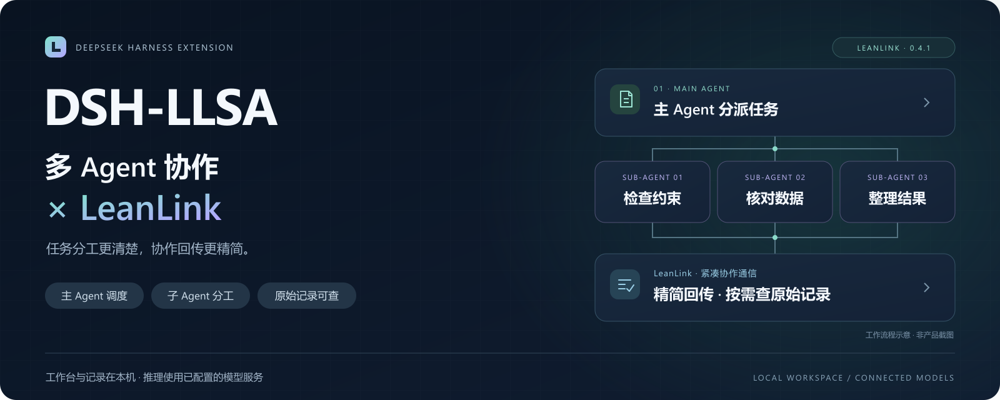
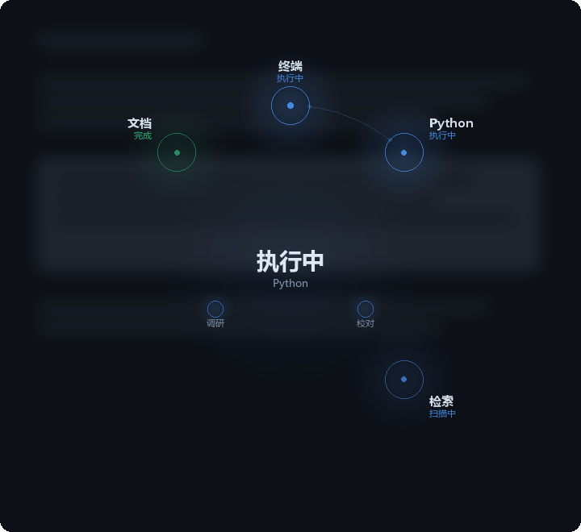
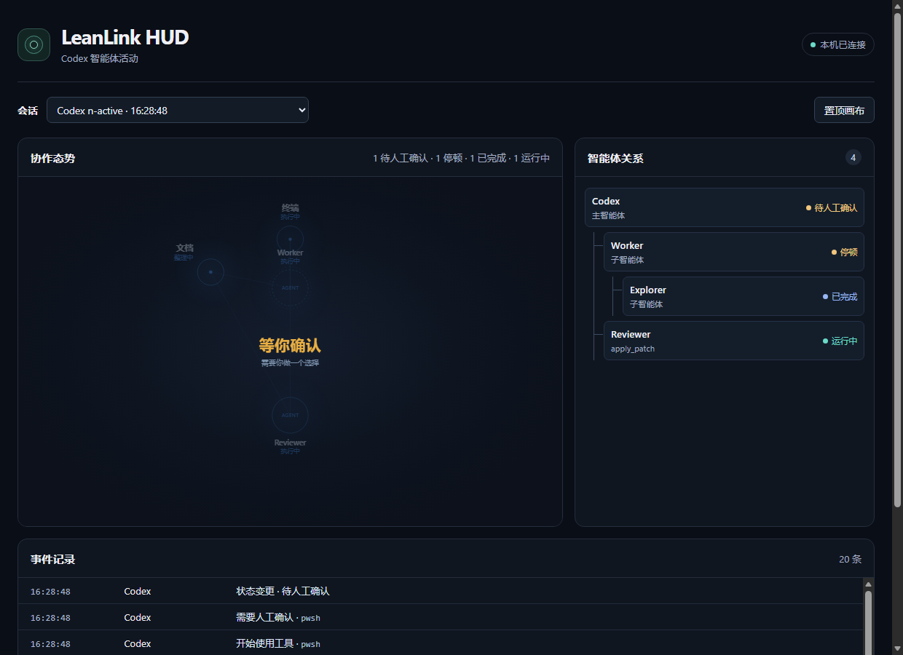

<p align="center">
  
</p>

<h1 align="center">DSH-LLSA</h1>
<p align="center"><a href="README.md">简体中文</a> · English</p>
<p align="center">Delegate work to local agents, review their results, and trace each handoff back to the original evidence.</p>

<p align="center">
  <a href="https://github.com/TaoruiLiu19/DSH-LLSA/actions/workflows/ci.yml"></a>
  <a href="LICENSE"></a>
  
</p>

<p align="center">
  <a href="#quick-start">Quick start</a> · <a href="#your-first-handoff">First handoff</a> · <a href="#optional-features">Optional features</a> · <a href="#usage-and-cost">Usage and cost</a> · <a href="#development-and-verification">Development</a>
</p>

DSH-LLSA helps with evidence review, code checks, and data work on a single machine. A coordinator assigns work and reviews results. Workers carry out their assignments and use **LeanLink** to send concise results with evidence references. Corrections create a new input version, and earlier results remain available for inspection.

## Choose an entry point

| Your host | What you can do | Start here |
| --- | --- | --- |
| **DeepSeek Harness** | Submit work items, delegate, review results, and inspect evidence and model usage | [Install the combined kit](#quick-start) |
| **Harness HUD** | Follow tool activity, child-agent state, and requests for attention in a Harness chat | [HUD installation guide](https://github.com/TaoruiLiu19/DSH-LLSA/tree/main/packages/hud#readme) |
| **Codex** | Archive subagent results with LeanLink and view activity beside your chat in the built-in browser | [Codex installation and split view](#codex-split-view-hud) |
| **WorkBuddy** | Preview source for a local browser HUD | [Preview status and startup limits](https://github.com/TaoruiLiu19/DSH-LLSA/blob/main/packages/hud-workbuddy/README.md) |

**Main branch update (2026-11-17)**

- **Web Collab** source is now `0.2.2`. Pages, assets, and API requests first pass through the Harness connection check. Use the terminal link to authenticate and keep the Harness tab open while you use Web Collab. [Change](https://github.com/TaoruiLiu19/DSH-LLSA/commit/5b1cd2b38b8fae146c0546f1a2c6c9085b2aecd0)
- **WorkBuddy HUD** adds a local browser view, a hook relay, and maintenance scripts. The current checkout is missing `lib/adapter.js` and `lib/tool-map.js`, so startup and standalone tests fail to resolve those modules. The adapter files are required before following the setup guide. [WorkBuddy source guide](https://github.com/TaoruiLiu19/DSH-LLSA/blob/main/packages/hud-workbuddy/README.md)

## Quick start

Use **Node.js 24.11+** and **npm 11+**. The first dependency installation requires internet access. Clone the repository, or use **Code → Download ZIP** on GitHub and start at `npm ci` in the extracted source directory.

```sh
git clone https://github.com/TaoruiLiu19/DSH-LLSA.git
cd DSH-LLSA
npm ci
npm run build
npm start
```

Open the Harness authentication link printed in your terminal. The default address is `127.0.0.1:3095`. Keep the terminal running and open these paths on the same address.

| Page | What it does |
| --- | --- |
| `/orchestrator/local` | Submit work items and see progress and final replies |
| `/collab` | Run local exact calculations or inspect the agent tree, evidence, and model usage |
| `/web-collab` | Submit first-pass advice or paste consultation replies after enabling Web Collab |

<details>
<summary><strong>Start from a CI build and skip the source build</strong></summary>

Sign in to GitHub, choose a successful `main` run, and download a Windows or Ubuntu archive from **Artifacts**. Extract the outer ZIP and compare the SHA-256 for `dsh-llsa-0.4.2.tgz` against its entry in `SHA256SUMS`. [Workflow runs](https://github.com/TaoruiLiu19/DSH-LLSA/actions/workflows/ci.yml?query=branch%3Amain)

```sh
tar -xzf dsh-llsa-0.4.2.tgz
cd package
npm ci
npm start
```

Keep `vendor/`, `package.json`, and `package-lock.json` from the archive. The installer uses the bundled component files and the recorded dependency versions. Use `Get-FileHash .\dsh-llsa-0.4.2.tgz -Algorithm SHA256` in PowerShell or `sha256sum dsh-llsa-0.4.2.tgz` on Ubuntu. The entry-point table links to separate setup for Codex and the HUDs.

</details>

### Try an example without a model API

In `/collab`, find **Local exact calculation** (`本机精确计算`). Choose **Fill example** (`填入示例`) and then **Preview rule and result** (`预览规则和结果`). The sample sums two matching rows to **171**. Choose **Confirm rule and save result** (`确认规则并保存结果`) to save a local record of the rule and result. This example runs without a model configuration or a model call.

## Your first handoff

Set up your model API in Harness, then visit `/orchestrator/local`. Select **Require a JSON-only final reply** (`最终回复必须为纯 JSON`), paste the work item, and submit it to Super-agent.

```text
Ask one child agent to check the source, then review its result before replying.
The exact ID is the string "007". No tests have run, the fix is unverified,
and deployment is prohibited.
Return only a JSON object with id, test_status, fix_verified, and deploy_allowed.
Keep the leading zeros. Use "not_run" for test_status and booleans for the last two fields.
```

```json
{
  "id": "007",
  "test_status": "not_run",
  "fix_verified": false,
  "deploy_allowed": false
}
```

Select the work item in `/collab` and follow the collaboration tree through assignment, handoff, and review. Open the saved evidence and check `"007"` and both `false` values. When a user adds or corrects source material, update the same work item and review affected results against its current version.

For real work, describe the sources you want checked, what can be delegated independently, and the acceptance criteria. A direct question is enough for simple work. The work-item view keeps assignments and evidence together when several branches need review.

## Optional features

### Harness and Codex HUDs

<p align="center">
  
  
</p>

The Harness HUD on the left is installed separately as `@dsh-llsa/hud` and opens in a Harness chat. The Codex demo on the right shows agent relationships, tool activity, and event history. Both HUDs are read-only. Use work-item records to confirm the coordinator's acceptance decision. [Harness HUD guide](https://github.com/TaoruiLiu19/DSH-LLSA/tree/main/packages/hud#readme)

### Codex split-view HUD

Build and register **LeanLink for Codex** from the **repository source directory**. Use a Codex build that supports local plugins and make the `codex` command available in your terminal.

```sh
node scripts/build-codex-marketplace.mjs
codex plugin marketplace add ./artifacts/codex-marketplace
codex plugin add leanlink-codex@dsh-llsa-codex
node artifacts/codex-marketplace/plugins/leanlink-codex/hud/serve.mjs
```

Review and trust the plugin's hooks in Codex. On Windows, press `Ctrl+T` to open the built-in browser, enter the local URL printed in the terminal, and press `Ctrl+Shift+B` to switch to split view. Open a new session, pick **leanlink-codex:leanlink** from the `$` skill menu, and delegate a task. Use references to recover saved evidence. The HUD renders activity reported by Codex. [Full installation, permissions, and retrieval guide](https://github.com/TaoruiLiu19/DSH-LLSA/blob/main/packages/codex/README.en.md)

### Local CSV work items

Use **Python 3.10+**. After building from source or installing the extracted `package/` kit, point the launcher at the included sample directory.

```powershell
$env:DSH_LLSA_CSV_WORKSPACE = (Resolve-Path '.\examples\csv-workflow').Path
npm start
```

```sh
DSH_LLSA_CSV_WORKSPACE="$PWD/examples/csv-workflow" DSH_LLSA_CSV_PYTHON=python3 npm start
```

Select a work item in `/collab` and enable **Local CSV** (`本机 CSV`). Set `DSH_LLSA_CSV_DEFAULT_ON=1` before launch to enable it for new work items from their first planning call. Ask the coordinator to process `workflow.csv` and `workflow-next.csv` as one batch. Keep registered rows (`已报名`), retain the latest registration per email, and count by region. Expect **North 1 and South 2** in the first file and **East 2 and South 1** in the second.

The local executor applies the filters, deduplication, and counts. Model calls cover planning, interpretation, and review. A batch accepts two to four files, up to 16 MiB each and 32 MiB combined. Downstream agents receive references to accepted outputs. Turning the work-item switch off cancels queued local CSV work. Steps already in progress can finish and receive a review. [Saved rules and column mappings](https://github.com/TaoruiLiu19/DSH-LLSA/tree/main/task-reuse#readme)

### Web collaboration

Web collaboration is off by default. Stop the running instance and start from the source directory or the extracted `package/` using the commands for your system.

```powershell
$env:DSH_LLSA_WEB_COLLAB = '1'
npm start
```

```sh
DSH_LLSA_WEB_COLLAB=1 npm start
```

Open the Harness authentication link first, then visit `/web-collab` and enable **Web collaboration** (`网页协作`) for that work item. For manual consultation, copy a question to a chat site such as ChatGPT or DeepSeek and paste back the reply with its consultation ID. With Open WebUI configured, opted-in tasks can receive replies through its API. Harness agents review any advice against the source before delivery. Track web and Harness usage separately and include any upstream Open WebUI charges in the total. [Manual and Open WebUI setup](https://github.com/TaoruiLiu19/DSH-LLSA/tree/main/packages/web-collab#readme)

## Usage and cost

LeanLink gives each branch a reference to current input plus its acceptance criteria. The coordinator receives a concise result and evidence references. Long material can be read in pages, and historical versions remain available. An `input:` reference is scoped to one run, so open it from the corresponding work item. A finished agent turn and the coordinator's acceptance decision are distinct events.

Use `/collab` to inspect the agent tree, cache hits and misses, output, retries, and missing usage. Select a connection to inspect recorded dispatch and handoff events. The cost sliders model prices, caching, and compression scenarios. For a comparison against another workflow, hold the task and acceptance criteria fixed and include failures, rework, and any external consultation charges.

<details>
<summary><strong>Configure an optional model-call budget</strong></summary>

Copy the [sample policy](examples/money-policy.example.json) and enter the provider, model, currency, and prices per million tokens for each route you use. Set `DSH_LLSA_MONEY_POLICY` to the policy's absolute path before launch. `maxCost` applies to one budget period, `maxRunCost` to one run, and `maxBranchCost` to one work item including retries. Keep the same `id` to continue an existing budget period.

Before each managed call, the app reserves an estimate based on input and allowed output. It stops admitting new calls if a price is missing or a budget would be exceeded. Calls already sent may finish. Missing metering leaves reservations open. After updating a budget, restart and manually resume the work. Older usage retains its original rate. Consult the provider's bill for the actual amount charged.

</details>

## Troubleshooting

| Problem | What to check |
| --- | --- |
| The local page is blocked or fails authentication | Reopen the authentication link for this startup. Use `npm start -- 3096` if the default port is busy. |
| Model calls fail or return 401 or 429 | Check model configuration, account balance, and rate limits in Harness. |
| The CSV work item cannot find a sample | Check Python 3.10+, the work-item switch, and `DSH_LLSA_CSV_WORKSPACE`. Input paths are relative to that directory. |
| Codex HUD shows no sessions | Confirm the HUD server is running and the hooks are trusted, then run a task in a new session. |
| How to back up | Stop with `Ctrl+C`, then back up the entire `.dsh-llsa/` directory. Set `DSH_LLSA_STATE` to choose a different location. Harness manages its own credentials. |

When reporting an issue, include the OS, Node/npm versions, launch method, and a redacted error. Keep model keys, authentication links, and local databases private.

## Development and verification

| Component | Source version and purpose |
| --- | --- |
| Combined kit, launcher, Super-agent, and Collab | `0.4.2`. Local startup, work items, LeanLink handoffs, and records |
| DeepSeek Harness | Pinned to `0.2.2-rc.1` |
| Web Collab | `0.2.2`. Optional web consultation |
| Harness HUD | `0.4.5` source. Installed separately |
| Codex / WorkBuddy HUD | Local marketplace build for Codex, source preview for WorkBuddy |

```sh
npm run check
npm run typecheck
npm test
npm run check --prefix packages/hud
npm run pack:release
npm run verify:rebuild
npm run verify:kit
```

CI validates builds, isolated installations, and archive SHA-256 on Windows and Ubuntu. Run `node scripts/smoke-codex-plugin.mjs --native-hud` to check MCP installation, exact evidence retrieval, and native parent and child hooks on a local Codex installation. The smoke test uses a local fixture endpoint.

<details>
<summary><strong>HUD v1 snapshots and replay fixtures</strong></summary>

Use `GET /collab/api/runs/:runId?view=hud` for the sanitized read-only snapshot. Track `seq` per run and use the server's `stalled` and attention state. Choose the reported alias table version for tool labels. The schema version stays at 1. A finished turn and an accepted work item have separate meanings. [Schema](contracts/hud-v1.schema.json) · [Replay fixtures](https://github.com/TaoruiLiu19/DSH-LLSA/tree/main/contracts/fixtures) · [Alias table v1](contracts/tool-aliases-v1.json) · [v2](contracts/tool-aliases-v2.json) · [v3](contracts/tool-aliases-v3.json)

</details>

Back up the complete state directory before upgrading. When moving to a different Harness version, verify the lockfiles, versioned inputs, acceptance, stop/resume, and recovery from existing state together. The default workspace uses loopback. Enabled external integrations may use local credentials. `DSH_SUPERAGENT_BLOCKED_COMMANDS` provides advisory command restrictions.

Independent extension built on [DeepSeek Harness](https://github.com/deepseek-ai/deepseek-harness) and the [DeepSeek Super-agent research prototype](https://github.com/deepseek-ai/dsh-superagent-prototype/commit/8c32a9dc5d72c033816c6a8110b37f40cf94fba4). [MIT License](LICENSE) · [Upstream notices](NOTICE) · [Changelog](CHANGELOG.md)
