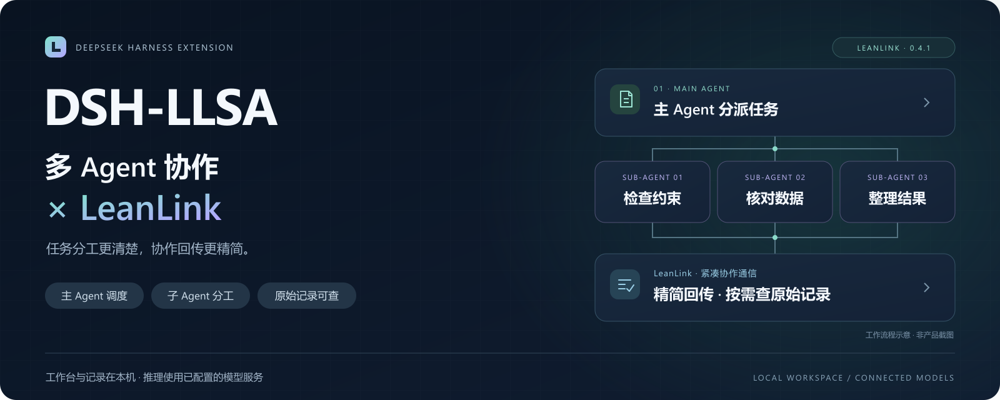

<p align="center">
  
</p>

<h1 align="center">DSH-LLSA</h1>
<p align="center"><strong>简体中文</strong> · <a href="https://github.com/TaoruiLiu19/DSH-LLSA/blob/main/README.en.md">English</a></p>
<p align="center"><strong>让多个 Agent 一起完成任务，让每一次协作更精简。</strong></p>
<p align="center">DeepSeek Harness 上的本机多智能体工作台<br>由 <strong>LeanLink</strong> 连接任务分工、紧凑通信与可追溯记录。</p>

<p align="center">
  <a href="https://github.com/TaoruiLiu19/DSH-LLSA/actions/workflows/ci.yml"></a>
  <a href="LICENSE"></a>
  
</p>
<p align="center"><a href="#快速开始">快速开始</a> · <a href="#第一次协作">第一次协作</a> · <a href="#认识-leanlink">认识 LeanLink</a> · <a href="#网页协作">网页协作</a> · <a href="#hud-专注视图">Harness HUD</a> · <a href="#codex-分屏-hud">Codex HUD</a> · <a href="#使用帮助">使用帮助</a></p>

---

## 一句话交代任务，一处查看协作

把资料和验收要求交给主 Agent，由它组织子 Agent 分工，再汇总交付。你可以在本机工作台查看任务状态、结果与保存的协作记录。

| 分工更清楚 | 回传更精简 | 过程可核对 |
|:---|:---|:---|
| 主 Agent 组织任务，子 Agent 执行具体工作 | LeanLink 为受支持的结构化信息选择紧凑表示 | 按需查看已保存的步骤、原文、产物与用量 |

适合从**资料齐全、范围明确、结果可核对**的任务开始：字段提取、规则核验、材料对比，或让多个子任务分别检查同一份输入。

> **当前版本：0.4.2。** 快速开始面向本机单用户使用。工作台与记录保存在本机，推理使用你配置的模型 API；调用费用由使用者承担。

## 组合包包含什么

DSH-LLSA 把工单编排、Agent 协作、启动器和可选的网页协作装进同一个安装包，四个组件随 `npm ci` 一起安装。

| 内置组件 | 使用时负责什么 |
|---|---|
| `@dsh-llsa/superagent` | 基于 DeepSeek 公开研究原型修改，负责接收本机工单、分派任务和验收交付 |
| `@dsh-llsa/collab` | 管理子 Agent、紧凑回传、历史与用量记录，并提供可选的本机 CSV 执行器 |
| `@dsh-llsa/launcher` | 按锁定版本启动 DeepSeek Harness，并加载上述组件 |
| `@dsh-llsa/web-collab` | 提供网页初审和子 Agent 咨询，默认关闭 |

使用 `/orchestrator/local` 提交工单，使用 `/collab` 查看协作记录。想在 Harness 对话界面实时看 Agent 状态时，可以[单独安装 HUD](https://github.com/TaoruiLiu19/DSH-LLSA/blob/main/packages/hud/README.zh.md)。

## 快速开始

准备 **Node.js 24.11+、npm 11+ 和 Git**，然后在终端执行：

```sh
git clone https://github.com/TaoruiLiu19/DSH-LLSA.git
cd DSH-LLSA
npm ci
npm run build
npm start
```

没有 Git？使用仓库页面的 **Code → Download ZIP**，解压后进入包含 `package.json` 的目录，从 `npm ci` 开始执行。

安装完成后只需三步：

1. **打开认证链接** — 点击终端输出的 Harness 链接，完成本机认证。
2. **配置模型** — 在 Harness 原生模型设置中填写自己的 DeepSeek 官方 API 配置。
3. **提交任务** — 打开同一地址下的 `/orchestrator/local`；协作记录在 `/collab` 查看。

默认地址为 `127.0.0.1:3095`。先打开认证链接，再进入任务页面。首次安装需要联网，请保留默认安装脚本，不要添加 `--ignore-scripts`。

### 交付文件

1. 在本机任务页选择 **文件交付**，写清任务要求和验收条件。需要新建文件时，填写 `index.html, styles.css` 等工作区相对路径。
2. 添加已有 UTF-8 文件。文件默认作为只读资料。要修订某个文件时，勾选 **作为可修改文件**。可以给每个文件填写相对路径，例如 `docs/说明.md`。单次最多添加 12 个文件，单个最多 180 KiB，合计最多 512 KiB。
3. 在 **工单与成品** 查看进度、下载文件，或追加要求。验收通过的版本标为 **已交付**。已经写到本机的工作文件可以 **下载草稿**。追加要求沿用同一工作区和文件范围。

执行到达预算上限时，工单会显示原因并保留已写文件。点击 **从已保存文件继续** 会在同一工作区启动新的执行轮次，使用所配置模型的额度，后续仍需主 Agent 验收。只想取走当前文件时，可直接下载草稿。

协调者验收时复核文件大小和 SHA-256，功能要求按任务证据判断。通过本机任务 API，可用 `artifactFiles` 声明输出，`artifactInputs` 声明只读路径，`workspaceFiles: [{path, text}]` 提供这些路径的初始内容。输出路径和只读路径各可声明最多 12 项。文件工单使用文本回复。

<details>
<summary><strong>从 GitHub Releases 下载组合包</strong></summary>

从 [GitHub Releases](https://github.com/TaoruiLiu19/DSH-LLSA/releases) 下载 `dsh-llsa-0.4.2.tgz` 和 `SHA256SUMS`，核对 SHA-256 后解包安装。这个包包含启动器和 Harness 的锁定依赖。

```sh
tar -xzf dsh-llsa-0.4.2.tgz
cd package
npm ci
npm start
```

保留解压后目录里的 `vendor/`、`package.json` 和 `package-lock.json`。`vendor/` 已装入四个组件包，安装时还需要联网下载 Harness 等锁定依赖。真实任务使用自己配置的模型 API。

</details>

已经安装了 Harness Web？从同一个 Release 下载 `dsh-llsa-harness-bundle-0.4.2.tgz`，用 `dsh plugin add` 装到专用 Web 配置。[插件安装指南](https://github.com/TaoruiLiu19/DSH-LLSA/blob/main/packages/harness-bundle/README.zh.md)

### HUD 专注视图

**不用盯着滚动日志，也能知道 Agent 正在做什么。** 可选 HUD 为 Harness 会话增加实时浮层：中心显示执行、等待确认与完成状态，外圈以固定位置展示终端、代码、检索、文档、网页等活动，多 Agent 时显示子 Agent 状态。

- 按 **Esc** 返回对话，点击状态胶囊重新查看；`Ctrl/Cmd+Shift+H` 临时隐藏。
- **HUD 自身不调用模型**；LeanLink 优化协作通信，HUD 帮你看清运行状态。准确用量仍在 `/collab` 查看。
- 在 Harness 插件页单独安装并启用 `@dsh-llsa/hud`。开发时也可以使用源码目录 `packages/hud`。浮层显示在 Harness 会话页。

→ **[HUD 安装、使用与常见问题](https://github.com/TaoruiLiu19/DSH-LLSA/blob/main/packages/hud/README.zh.md)**

### Codex 分屏 HUD

从仓库源码安装独立的 **LeanLink for Codex** 插件，可保存分支结果和证据引用。启动本机 HUD 后，在 Windows 的 Codex 桌面端按 `Ctrl+T`，粘贴终端打印的地址，再按 `Ctrl+Shift+B` 循环切换至分屏。也可以在本机浏览器打开该地址。审核并信任插件 Hook 后，HUD 会显示宿主上报的父子 Agent、工作状态和待确认事件。 [Codex 安装及权限说明](https://github.com/TaoruiLiu19/DSH-LLSA/blob/main/packages/codex/README.md)

### 工单内置 CSV 工作流

工单可在本机执行已明确规则的 CSV 筛选、去重和统计。协调者可以把多份输入交给同一个工作项，验收后将产物交给下游。执行器随 DSH-LLSA 源码构建和安装包提供。

要在协作工单中启用本机 CSV 步骤，可在仓库根目录用 PowerShell 指定一个专门存放输入 CSV 的目录。需要 Python 3.10+。以下命令用附带的合成样例启动。

```powershell
$env:DSH_LLSA_CSV_WORKSPACE = (Resolve-Path '.\examples\csv-workflow').Path
npm start
```

在 `/collab` 选中工单后，可随时切换「本机 CSV」，默认关闭。关闭后，新模型请求的工具列表会移除此能力，排队中的本机 CSV 工作项会取消，已经开始的步骤仍可完成并验收。要让新工单从第一次执行规划起就可以使用，可在启动前另设 `$env:DSH_LLSA_CSV_DEFAULT_ON = '1'`。工单一旦开始，开关状态独立保存。

- **分派时**，工单协调者知道确切规则时，可在一个本机工作项内合并筛选、去重和分组计数。
- **处理多批数据时**，可对 2–4 份带批次名的 CSV 一次提交同一套步骤。每份最多 16 MiB，整批最多 32 MiB。整批成功才提交验收，验收后下游直接收到带批次名的产物引用。出现错误时，回执会标出批次和步骤。停止本机任务时会结束正在执行的 CSV 工作项。
- **子 Agent 执行时**，协调者在分派时绑定 CSV 引用，只给需要确定性处理的工作项开启转换权限。子 Agent 一次处理这份 CSV 后继续分析和提交。只读取和解读产物的子 Agent 不加载转换工具。
- **回传时**，本机执行只返回行数、检查结果和产物引用。需要理解文本、判断业务规则或处理没有 CSV 的任务时，沿用普通流程。

在任务页试用「用本机 CSV 工作项处理 `workflow.csv`，筛选已报名记录，按邮箱和报名时间保留最新一条，再按地区计数。验收后让子 Agent 根据产物给出一句结论」。

也可以试「对 `workflow.csv` 和 `workflow-next.csv` 使用同一个批量工作项，分别统计已报名人数。按邮箱保留报名时间最新的一条，再按地区计数。给两份产物标上第一批和第二批，验收后对比地区变化」。第一批应为北区 1、南区 2，第二批应为东区 2、南区 1。

无需 API 的回归测试覆盖批次执行、产物验收和子 Agent 授权。按以上方式处理 CSV 时，确定性步骤在本机执行，模型规划、分析和验收仍会使用 token。含 CSV 工具事件的快照使用别名表 v2，识别该工具类别可使用本仓库 `packages/hud`。

已保存规则、表头映射和 MCP 等用法见 [独立 Task Reuse 使用说明](https://github.com/TaoruiLiu19/DSH-LLSA/blob/main/task-reuse/README.md)。

### 网页协作

**默认关闭。** 网页可为本机任务提供初审或核对建议，由 Harness Agent 核对原始资料并交付结果。完成源码构建或安装包含网页协作的 CI 构建包后，先退出正在运行的实例。进入源码根目录或解压后的 `package/`，按操作系统选择启动命令。

```powershell
$env:DSH_LLSA_WEB_COLLAB = '1'
npm start
```

```sh
DSH_LLSA_WEB_COLLAB=1 npm start
```

先打开终端打印的 Harness 认证链接，再访问同一地址的 `/web-collab`。每个任务在页面勾选 **网页协作** 后才会使用建议。打开 **多智能体** 后，在任务框粘贴资料，LLSA 会分派并验收工单，子 Agent 可按需咨询本分支的疑点。单 Agent 模式支持附件。多智能体工单的进度和回复可在 `/orchestrator/local` 查看，协作记录和 Harness 模型用量在 `/collab` 查看。

- **手动咨询**适用于 ChatGPT、DeepSeek 等聊天网页。复制咨询提示，在网页发送，再把回复粘贴回来。为子 Agent 回填时，保留回复里的咨询编号，也可导入对应的 Markdown 文件。
- **自动咨询**适用于已配置的 Open WebUI。在启动前设置 `DSH_WEB_COLLAB_OPEN_WEBUI_URL`（实例地址）、`DSH_WEB_COLLAB_OPEN_WEBUI_MODEL`（模型 ID）和 `DSH_WEB_COLLAB_OPEN_WEBUI_KEY`（API 密钥）。非本机地址使用 HTTPS，密钥保留在本机启动环境。配置后可用页面的 **用 Open WebUI 咨询** 获取初审建议，启用网页协作的子 Agent 也可自动获取回复。[Open WebUI 官方接口](https://docs.openwebui.com/reference/api-endpoints/#chat-completions)

咨询只发送你提供的内容或当前分支用于核对的片段。发送前确认这些资料允许交给所选服务。网页回复是参考意见，最终核对和交付仍由 Harness Agent 完成。网页侧用量与 Harness 侧用量应分别记录，整单费用取决于咨询是否替代了其他模型请求。Open WebUI 所连接的模型可能单独收费，这笔费用由其模型服务计收，超出本机 Harness 预算的统计范围。

要关闭功能，将 `DSH_LLSA_WEB_COLLAB` 清除或设为 `0`，再重启 DSH-LLSA。
此前使用 `dsh plugin` 单独安装过网页协作时，先从同一 Harness 配置中移除独立安装，再使用组合包内置版本。

## 第一次协作

<details>
<summary><strong>可选：为真实调用启用金额预算</strong></summary>

复制 `examples/money-policy.example.json` 为自己的配置文件，填写 Harness 实际使用的 provider、model、币种及每百万 token 的费率。示例中的名称和费率只是占位，不能直接用来估算账单；每个会用到的模型都需要配置。`cacheWrite` 是否单独计费取决于供应商，按其用量口径填写，不能重复计算。

Windows PowerShell：

```powershell
$env:DSH_LLSA_MONEY_POLICY = (Resolve-Path './my-money-policy.json').Path
npm start
```

macOS / Linux：

```sh
DSH_LLSA_MONEY_POLICY="$PWD/my-money-policy.json" npm start
```

`maxCost` 限制同一 `id` 预算周期内**所有已接入的受管调用**，包含主模型和子模型；`maxRunCost` 限制一个工单执行批次，`maxBranchCost` 限制一个工作项及其重试（根协调调用单独计为 `root` 分支）。主模型跨工单调用仍归主模型会话，不强行分摊到单个工单。周期不会按日期自动重置；修改 `id` 明确开启新周期。

每次调用前按本地输入 token 估计、输出额度和较高的输入费率预留，再乘 `reserveMultiplier`。达到 80% 留下提示事件，预留后将超限则拒绝新调用并暂停该 run。缺少模型价格同样拒绝调用；未知用量持续占用预留，重启和点击继续均不会清空。已有调用可能继续完成，外部操作不会自动回滚。

在 `/collab` 的模型用量区查看周期、工单与分支额度及最近阻止原因。需要续额时，先停止程序，保持 `id` 和币种不变，修改额度后重启，再人工恢复或重试任务。旧调用仍使用当时记录的费率，不被新费率重算。不要把重试当成清空历史。

金额是**用量估算加未结清预留，不是供应商账单硬上限**：本地 tokenizer、输出上限执行情况、供应商计费及未接入的请求都可能造成偏差；实际回传高于预留会计入后续准入。未配置本选项时保留原有 token 限制，预测滑块不控制真实花费。启用前的调用不追溯扣入新预算周期。

</details>

打开任务页，粘贴以下内容。这个小例子便于直接核对结果，并观察一次委托与回传。

```text
请交给一个子 Agent 核对以下资料，再由主 Agent 检查结果。

原始编号是字符串 "007"，必须保留前导零。
测试尚未执行，修复效果尚未验证，当前不允许部署。

只返回一个 JSON 对象：
- id：原始编号，字符串。
- test_status：只能是 "passed"、"failed" 或 "not_run"。
- fix_verified：修复是否已验证，布尔值。
- deploy_allowed：是否允许部署，布尔值。

不得补造测试结果，不添加说明或 Markdown 代码围栏。
```

勾选 **“最终回复必须为纯 JSON”**，点击 **“提交给 Super-agent”**。检查结果是否符合：

```json
{
  "id": "007",
  "test_status": "not_run",
  "fix_verified": false,
  "deploy_allowed": false
}
```

接着打开 `/collab`，查看本次保存的协作记录。这里的 JSON 是验收标准；任务结束、格式合法和内容正确，需要分别核对。

## 认识 LeanLink

**LeanLink 关注多 Agent 之间的通信成本。** 对受支持的结构化字段采用紧凑表示，自由文本保留原文；需要检查某一步时，回到保存的原文、结构化结果和产物记录。

| 你能得到 | 使用边界 |
|---|---|
| 主 Agent 调度与子 Agent 分工 | 并非所有小任务都值得多 Agent 协作 |
| 紧凑表示与结构化交付 | 不保证任意自然语言都能压缩，也不是保密加密 |
| 可查询的步骤与原始记录 | 不提供模型内部隐藏推理的完整回放 |
| 原生工单的输入引用与历史版本 | 子任务按引用读取完整资料；追加要求后，旧结果需要重新核对 |
| 子任务提交后自动结束该轮 | 保留父 Agent 验收，失败或未完成的结果不能自动算作通过 |
| 区分供应商回传、估算和未知的 token 记录 | 未知不等于零；统计不是账单 |
| 纯 JSON 输出约束与关键值检查 | 格式校验不能替代事实与业务正确性验证 |

实际节省程度取决于任务、模型、重试和输出长度，应使用相同任务的真实用量对比。本项目不承诺固定 token 降幅或正确率。

**资料很长时怎么用？** 在任务里写清目标、约束和验收标准即可。接入原生工单的 worker 会获得可用的输入引用，无需反复把整段资料抄进委托参数。读取结果带有分页位置，长资料可以继续读取；查询过去的结果时，历史版本仍保留原文。`input:` 引用属于当前工单执行批次，不能复制到另一个任务使用。

### 长短任务实测

2026-11-26，我们用两道公开 DROP 短题和两项含资料更新的多轮长任务，对比了单 Agent、原版 SuperAgent、当前 DSH-LLSA，以及 LangGraph、AutoGen、CrewAI 各自接入 LeanLink 前后的表现，共 36 个实测单元。单 Agent 和协调者使用 Sol high，协作组的执行者使用 Luna xhigh。严格得分同时核对答案和证据引用，未正式交付的项目计零。[实测代码版本](https://github.com/TaoruiLiu19/DSH-LLSA/commit/a93207acc3d1a5202d9f3afe15407fc821f32436)

| 本机对照 | 短题严格得分 | 短题估算费用 | 长任务正式交付 | 长任务严格得分 |
| --- | ---: | ---: | ---: | ---: |
| 单 Agent | 6/6 | $0.03715 | 9/9 轮 | 65/72 |
| 原版 SuperAgent | 6/6 | ≥ $0.36238 | 1/9 轮 | 8/72 |
| 当前 DSH-LLSA（文件模式） | 6/6 | $0.13067 | 4/9 轮 | 32/72 |

同样答对两道短题，DSH-LLSA 比原版 SuperAgent 的已知费用低约 64%，是单 Agent 的 3.52 倍。文件工单增加了读写和验收调用。长任务中，LLSA 的一项首跑遇到实验转接错误。独立复测仍在后续轮次触及工单 token 预算，另一项长任务也在最后一轮触及预算。

三个外部框架的 12 对实验全部完成交付。长任务中，接入 LeanLink 后，交接字节减少 **98.63%**，严格得分从 **212/216** 到 **213/216**，模型总 token 增加 **0.07%**。按实测缓存命中折算，费用下降 **21.63%**。把同一批用量按全未命中重新计价，降幅为 **2.04%**。这些费用按模型回执估算，原版短题有一次用量回执缺失。样本范围内，交接压缩的结果一致，费用随缓存和任务而变化。

## 使用帮助

<details>
<summary><strong>启动、认证与 API 常见问题</strong></summary>

| 现象 | 处理方式 |
|---|---|
| Node/npm 版本不匹配 | 运行 `node --version`、`npm --version`；要求 Node ≥ 24.11、npm ≥ 11 |
| 依赖安装失败 | 检查网络与 registry，在源码根目录重新执行 `npm ci` |
| 3095 端口被占用 | 使用 `npm start -- 3096`，打开新认证链接 |
| 页面未认证或拒绝访问 | 先打开当前终端中的 Harness 认证链接 |
| Harness 版本不匹配 | 重新执行 `npm ci` 恢复锁定依赖，避免混用旧包 |
| 模型调用失败 | 检查 Harness 设置中的 API 地址、模型名称与额度 |

反馈问题时请提供系统、Node/npm 版本和脱敏错误信息。不要上传 API 密钥、认证链接或私人数据库。

</details>

<details>
<summary><strong>数据位置、停止与备份</strong></summary>

状态默认保存在启动目录的 `.dsh-llsa/`。按 **Ctrl+C** 并等待进程退出，再复制整个目录进行备份；不要只复制正在使用的 SQLite 文件，WAL/SHM 与关联产物也可能参与持久化。恢复时先停止服务，再恢复完整目录。

在线数据库快照可使用 SQLite `VACUUM INTO 'backup.db'`，但它不能替代关联产物的完整备份。Harness 的模型配置和凭据由 Harness 单独管理。

指定数据位置，Windows PowerShell：

```powershell
$env:DSH_LLSA_STATE = "D:\DSH-LLSA-data"
npm start
```

macOS / Linux：

```sh
DSH_LLSA_STATE="$HOME/dsh-llsa-data" npm start
```

</details>

<details>
<summary><strong>兼容版本与执行边界</strong></summary>

| 组件 | 版本 |
|---|---|
| DSH-LLSA 组合发行 / 启动器 | 0.4.2 |
| `@dsh-llsa/collab` | 0.4.2 |
| `@dsh-llsa/superagent` | 0.4.2 |
| `@dsh-llsa/web-collab`（默认关闭） | 0.2.2 |
| DeepSeek Harness | 0.2.2-rc.1 |

四个内置组件通过组合包安装。启动器按锁文件使用指定版本的 Harness。HUD 的 npm 包单独发行，[安装与版本信息见 HUD 文档](https://github.com/TaoruiLiu19/DSH-LLSA/blob/main/packages/hud/README.zh.md)。

组合包使用基于 [DeepSeek Super-agent 研究原型](https://github.com/deepseek-ai/dsh-superagent-prototype/commit/8c32a9dc5d72c033816c6a8110b37f40cf94fba4) 的修改版。完整工单流程依赖这份修改版提供的输入版本、验收和停止恢复接口。上游发布新版后，先验证兼容性及旧状态的恢复，再随组合包更新。现有安装可继续按原锁文件运行。[上游署名与派生说明](NOTICE)

默认本机入口不自动操作外部仓库或发布部署。源码保留上游外部集成能力；另行启用时可能使用本机 git、gh、lark 凭据并执行命令。`DSH_SUPERAGENT_BLOCKED_COMMANDS` 是建议性限制，不构成强制沙箱。服务仅供本机使用，不要直接暴露到公网。

</details>

## 开发与验证

### 可视化浮窗接口（只读）

编排层已预留多智能体工作状态投影，不依赖 HUD 包，也不实现浮窗布局或动画。

- 读取现有 `GET /collab/api/runs/:runId?view=hud`，获得符合 [HUD v1 Schema](contracts/hud-v1.schema.json) 的脱敏快照；不新增端点。
- 此端点需要 Harness 鉴权。同源页面可使用登录会话，独立客户端需携带本实例认可的凭据。HUD 默认使用本机会话事件。
- 原有完整任务快照保留兼容字段，新增 `hud`，以及与其一致的顶层 `v`、`seq`、`now`。浮窗应使用 `view=hud`，不要读取原始 `events` 或自行推导状态。
- `agents` 提供稳定 ID、父子关系、工单、五态、状态起始时间、静默标记和最小活动事件。`label` 是最多 12 个 Unicode 字符的短名：任务标题优先，其次会话标题；移除路径、URL、邮箱、纯数字 ID、代码与换行，过滤后为空则使用角色或“智能体”。原生 Assignment 无独立标题字段，适配器取关联任务的 `execution.name` / `ticket.title`；托管子任务使用分配时的 objective。每次 assignment 的短名持久化固定，变更经带 `label` 的 `agent.register` 发布。父节点可能属于另一个工单快照，不能据此猜测其活动状态。
- `seq` 在每个 run 内单调递增，重启不清零；客户端按 `(runId, seq)` 维护游标，跨 run 不可比较。轮询时间与 `stalled` 变化不会增加序号。`stalledAfterMs` 默认为 20000；只有 `running` 可以静默。`stalled` 由服务端计算，客户端只展示服务端值，不自行判断失败或静默。
- `tool` 保留原生工具 ID。快照按可见工具活动选择 `aliasVersion`。普通活动用 1，CSV 工具用 2，网页协作用 3，批量章节分派用 4，批量章节验收用 5，工作区文件工具用 6。HUD 快照的 `v` 仍为 1。旧映射保留，自定义名称或第三方工具可落“其它”。[别名表 v1](contracts/tool-aliases-v1.json) · [v2](contracts/tool-aliases-v2.json) · [v3](contracts/tool-aliases-v3.json) · [v4](contracts/tool-aliases-v4.json) · [v5](contracts/tool-aliases-v5.json) · [v6](contracts/tool-aliases-v6.json)
- `events` 是最近 256 条最小事件，`eventsFromSeq` 给出窗口起点。若客户端游标落后于窗口，直接采用最新状态并跳过丢失的动画，不回放猜测事件。事件的 `seq`、`agentId` 用于寻址；`state.changed` 额外提供 `from/to/reason`。
- turn 正常结束的 `done` 只表示本轮结束，不代表工单验收通过。取消或输入作废为 `idle`；进程重启后未闭合 turn 清理为 `idle`。缺失的工具/turn 结束以 `synthetic: true` 和原因显式补齐，绝不冒充成功。工具 id 不含参数、路径、命令或输出。
- 实际状态接入 `turn/start/end`、`tool/call/result`、审批对象与用户问题回复。等待确认不会因工具等待超时自动消失；收到用户回复后按是否有打开的 turn 恢复。历史上尚未接入的活动不补造。

浮窗开发可以直接读取五份回放夹具中的 `frames`：
[正常一轮](contracts/fixtures/hud-normal.json)、[输入作废](contracts/fixtures/hud-invalidated.json)、[重启清理](contracts/fixtures/hud-restarted.json)、[审批与提问等待／恢复](contracts/fixtures/hud-attention.json)、[20 秒静默边界](contracts/fixtures/hud-stalled.json)，另有 [短名边界用例](contracts/fixtures/hud-labels.json)。无需导入 manager/store 或投影实现。`steps` 的状态、序号与边界期望独立编写；同一事件序列必须生成相同 `frames`。`node scripts/update-hud-fixtures.mjs` 只刷新 frames，不修改期望值。

待确认由宿主 `userQuestions` 结构化视图、阻塞请求生命周期和 `approval/asked` / `approval/decided` 驱动，HUD 不解析工具返回文本。统一使用既有 `attention.raised`、`attention.resolved`；只有状态实际改变才发 `state.changed`。多个对象须全部处理后才恢复：有打开的 turn 则 running，否则 idle；取消清空集合并回到 idle，迟到的旧对象不会重新点亮。

兼容约定：本次保持 `v: 1`。加字段、kind 或状态属于约定的非破坏性扩展；既有字段语义保持不变。未来破坏性变更必须在同一个 PR 更新 schema、投影、夹具与回放测试；v1 继续默认，v2 由客户端显式选择，两个版本短期并存。只有可视化端明确确认迁移完成后才可弃用 v1。本版尚未发布 v2。独立安装、单智能体降级和视觉材料映射由 HUD 实现方负责。

```text
packages/dsh-collab/   协作通信与记录
packages/superagent/   上游派生的执行插件
packages/launcher/     本机启动器
packages/web-collab/   可选的网页协作入口
scripts/               构建、打包与安装验证
assets/                产品海报
```

在完成 `npm ci` 后运行：

```sh
npm run check
npm run typecheck
npm test
npm run pack:release
npm run verify:rebuild
npm run verify:kit
```

`pack:release` 先检查并构建，再生成五个归档与 `SHA256SUMS`。后两条命令分别检查重复构建一致性，以及全新目录中的安装、认证、页面与协作桥。已构建源码还可运行 `npm run smoke`。

这些验证使用隔离配置。`node scripts/smoke.mjs --delivery` 和组合包验收使用本机模拟模型，检查上传、下载、预算停止及恢复交付。真实复杂任务的完成率和费用需要单独实测。Windows / Ubuntu 各自验证通过后，CI 还会下载两套产物、核对实际归档哈希并比较 SHA256SUMS；文件名或内容不一致会让整个流程失败。远端状态见页首 CI 标记。构建产物通过 Actions 分发，不提交进源码树。

---

<p align="center"><strong>Built on DeepSeek Harness · Connected by LeanLink</strong></p>

基于 [DeepSeek Super-agent prototype](https://github.com/deepseek-ai/dsh-superagent-prototype) 与 [DeepSeek Harness](https://github.com/deepseek-ai/deepseek-harness)。采用 [MIT](LICENSE)，上游署名与派生说明见 [NOTICE](NOTICE)，版本变化见 [CHANGELOG](CHANGELOG.md)。本项目是独立扩展，不代表 DeepSeek 官方发布或背书。


### 协作树与费用推演

工作台新增父子 Agent 调用树，展示已记录的任务下发、结果回传和公开消息。点击连接可查看历史，并按连接调整压缩情景、费率、缓存命中及额外开销。已有阶段实验与情景预测分开展示。

滑块只做预测，不修改实际压缩策略；默认费率是示例。未知用量不补零，减少 token 也可能增加费用。当前不保证任意任务的固定降幅，后续完整验证尚未完成。

模型用量区可查看调用归属与返工统计，按 Agent、工作项、尝试和用途分组。用量覆盖率仅针对已记录的受管调用；缺少回传的请求仍计入未知。缓存命中率只在分项完整的调用上计算。输入变更造成的作废与实际重试分开统计，不能相加当作模型错误；未回传的费用不会被显示成免费。
