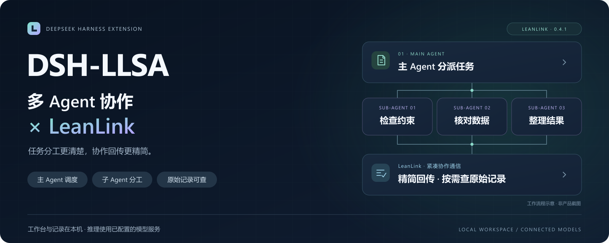

<p align="center">
  
</p>

<h1 align="center">DSH-LLSA</h1>
<p align="center"><strong>让多个 Agent 一起完成任务，让每一次协作更精简。</strong></p>
<p align="center">DeepSeek Harness 上的本机多智能体工作台<br>由 <strong>LeanLink</strong> 连接任务分工、紧凑通信与可追溯记录。</p>

<p align="center">
  <a href="https://github.com/TaoruiLiu19/DSH-LLSA/actions/workflows/ci.yml"></a>
  <a href="LICENSE"></a>
  
</p>
<p align="center"><a href="#快速开始">快速开始</a> · <a href="#第一次协作">第一次协作</a> · <a href="#认识-leanlink">认识 LeanLink</a> · <a href="#使用帮助">使用帮助</a></p>

---

## 一句话交代任务，一处查看协作

把资料和验收要求交给主 Agent，由它组织子 Agent 分工，再汇总交付。你可以在本机工作台查看任务状态、结果与保存的协作记录。

| 分工更清楚 | 回传更精简 | 过程可核对 |
|:---|:---|:---|
| 主 Agent 组织任务，子 Agent 执行具体工作 | LeanLink 为受支持的结构化信息选择紧凑表示 | 按需查看已保存的步骤、原文、产物与用量 |

适合从**资料齐全、范围明确、结果可核对**的任务开始：字段提取、规则核验、材料对比，或让多个子任务分别检查同一份输入。

> **当前版本：0.4.2。** 快速开始面向本机单用户使用。工作台与记录保存在本机，推理使用你配置的模型 API；调用费用由使用者承担。

## 快速开始

准备 **Node.js 24.11+、npm 11+ 和 Git**，然后在终端执行：

```sh
git clone https://github.com/TaoruiLiu19/DSH-LLSA.git
cd DSH-LLSA
npm ci
npm run build
npm start
```

没有 Git？使用仓库页面的 **Code → Download ZIP**，解压后进入包含 `package.json` 的目录，从 `npm ci` 开始执行。

安装完成后只需三步：

1. **打开认证链接** — 点击终端输出的 Harness 链接，完成本机认证。
2. **配置模型** — 在 Harness 原生模型设置中填写自己的 DeepSeek 官方 API 配置。
3. **提交任务** — 打开同一地址下的 `/orchestrator/local`；协作记录在 `/collab` 查看。

默认地址为 `127.0.0.1:3095`。先打开认证链接，再进入任务页面。首次安装需要联网，请保留默认安装脚本，不要添加 `--ignore-scripts`。

<details>
<summary><strong>使用构建包：跳过源码构建</strong></summary>

在 [Actions](https://github.com/TaoruiLiu19/DSH-LLSA/actions/workflows/ci.yml) 中打开一次成功运行，下载对应系统的构建产物 ZIP（需要登录 GitHub）。解压后找到 `dsh-llsa-0.4.2.tgz`，按同目录的 `SHA256SUMS` 核对，再解压并进入 `package/`：

```sh
npm ci
npm start
```

保留完整目录，特别是 `vendor/` 中的三个组件包。安装仍需要下载运行依赖，真实任务仍需模型 API。旧版 `0.4.0` 包不适用于本页。

</details>

## 第一次协作

<details>
<summary><strong>可选：为真实调用启用金额预算</strong></summary>

复制 `examples/money-policy.example.json` 为自己的配置文件，填写 Harness 实际使用的 provider、model、币种及每百万 token 的费率。示例中的名称和费率只是占位，不能直接用来估算账单；每个会用到的模型都需要配置。`cacheWrite` 是否单独计费取决于供应商，按其用量口径填写，不能重复计算。

Windows PowerShell：

```powershell
$env:DSH_LLSA_MONEY_POLICY = (Resolve-Path './my-money-policy.json').Path
npm start
```

macOS / Linux：

```sh
DSH_LLSA_MONEY_POLICY="$PWD/my-money-policy.json" npm start
```

`maxCost` 限制同一 `id` 预算周期内**所有已接入的受管调用**，包含主模型和子模型；`maxRunCost` 限制一个工单执行批次，`maxBranchCost` 限制一个工作项及其重试（根协调调用单独计为 `root` 分支）。主模型跨工单调用仍归主模型会话，不强行分摊到单个工单。周期不会按日期自动重置；修改 `id` 明确开启新周期。

每次调用前按本地输入 token 估计、输出额度和较高的输入费率预留，再乘 `reserveMultiplier`。达到 80% 留下提示事件，预留后将超限则拒绝新调用并暂停该 run。缺少模型价格同样拒绝调用；未知用量持续占用预留，重启和点击继续均不会清空。已有调用可能继续完成，外部操作不会自动回滚。

在 `/collab` 的模型用量区查看周期、工单与分支额度及最近阻止原因。需要续额时，先停止程序，保持 `id` 和币种不变，修改额度后重启，再人工恢复或重试任务。旧调用仍使用当时记录的费率，不被新费率重算。不要把重试当成清空历史。

金额是**用量估算加未结清预留，不是供应商账单硬上限**：本地 tokenizer、输出上限执行情况、供应商计费及未接入的请求都可能造成偏差；实际回传高于预留会计入后续准入。未配置本选项时保留原有 token 限制，预测滑块不控制真实花费。启用前的调用不追溯扣入新预算周期。

</details>

打开任务页，粘贴以下内容。这个小例子便于直接核对结果，并观察一次委托与回传。

```text
请交给一个子 Agent 核对以下资料，再由主 Agent 检查结果。

原始编号是字符串 "007"，必须保留前导零。
测试尚未执行，修复效果尚未验证，当前不允许部署。

只返回一个 JSON 对象：
- id：原始编号，字符串。
- test_status：只能是 "passed"、"failed" 或 "not_run"。
- fix_verified：修复是否已验证，布尔值。
- deploy_allowed：是否允许部署，布尔值。

不得补造测试结果，不添加说明或 Markdown 代码围栏。
```

勾选 **“最终回复必须为纯 JSON”**，点击 **“提交给 Super-agent”**。检查结果是否符合：

```json
{
  "id": "007",
  "test_status": "not_run",
  "fix_verified": false,
  "deploy_allowed": false
}
```

接着打开 `/collab`，查看本次保存的协作记录。这里的 JSON 是验收标准；任务结束、格式合法和内容正确，需要分别核对。

## 认识 LeanLink

**LeanLink 关注多 Agent 之间的通信成本。** 对受支持的结构化字段采用紧凑表示，自由文本保留原文；需要检查某一步时，回到保存的原文、结构化结果和产物记录。

| 你能得到 | 使用边界 |
|---|---|
| 主 Agent 调度与子 Agent 分工 | 并非所有小任务都值得多 Agent 协作 |
| 紧凑表示与结构化交付 | 不保证任意自然语言都能压缩，也不是保密加密 |
| 可查询的步骤与原始记录 | 不提供模型内部隐藏推理的完整回放 |
| 原生工单的输入引用与历史版本 | 子任务按引用读取完整资料；追加要求后，旧结果需要重新核对 |
| 子任务提交后自动结束该轮 | 保留父 Agent 验收，失败或未完成的结果不能自动算作通过 |
| 区分供应商回传、估算和未知的 token 记录 | 未知不等于零；统计不是账单 |
| 纯 JSON 输出约束与关键值检查 | 格式校验不能替代事实与业务正确性验证 |

实际节省程度取决于任务、模型、重试和输出长度，应使用相同任务的真实用量对比。本项目不承诺固定 token 降幅或正确率。

**资料很长时怎么用？** 在任务里写清目标、约束和验收标准即可。接入原生工单的 worker 会获得可用的输入引用，无需反复把整段资料抄进委托参数。读取结果带有分页位置，长资料可以继续读取；查询过去的结果时，历史版本仍保留原文。`input:` 引用属于当前工单执行批次，不能复制到另一个任务使用。

## 使用帮助

<details>
<summary><strong>启动、认证与 API 常见问题</strong></summary>

| 现象 | 处理方式 |
|---|---|
| Node/npm 版本不匹配 | 运行 `node --version`、`npm --version`；要求 Node ≥ 24.11、npm ≥ 11 |
| 依赖安装失败 | 检查网络与 registry，在源码根目录重新执行 `npm ci` |
| 3095 端口被占用 | 使用 `npm start -- 3096`，打开新认证链接 |
| 页面未认证或拒绝访问 | 先打开当前终端中的 Harness 认证链接 |
| Harness 版本不匹配 | 重新执行 `npm ci` 恢复锁定依赖，避免混用旧包 |
| 模型调用失败 | 检查 Harness 设置中的 API 地址、模型名称与额度 |

反馈问题时请提供系统、Node/npm 版本和脱敏错误信息。不要上传 API 密钥、认证链接或私人数据库。

</details>

<details>
<summary><strong>数据位置、停止与备份</strong></summary>

状态默认保存在启动目录的 `.dsh-llsa/`。按 **Ctrl+C** 并等待进程退出，再复制整个目录进行备份；不要只复制正在使用的 SQLite 文件，WAL/SHM 与关联产物也可能参与持久化。恢复时先停止服务，再恢复完整目录。

在线数据库快照可使用 SQLite `VACUUM INTO 'backup.db'`，但它不能替代关联产物的完整备份。Harness 的模型配置和凭据由 Harness 单独管理。

指定数据位置，Windows PowerShell：

```powershell
$env:DSH_LLSA_STATE = "D:\DSH-LLSA-data"
npm start
```

macOS / Linux：

```sh
DSH_LLSA_STATE="$HOME/dsh-llsa-data" npm start
```

</details>

<details>
<summary><strong>兼容版本与执行边界</strong></summary>

| 组件 | 版本 |
|---|---|
| DSH-LLSA 组合发行 / 启动器 | 0.4.2 |
| `@dsh-llsa/collab` | 0.4.2 |
| `@dsh-llsa/superagent` | 0.4.2 |
| DeepSeek Harness | 0.2.2-rc.1 |

包通过本地构建与随包文件安装，保持 `private: true`；这些名称不是已在 npm 发布的承诺。快速开始会启动指定版本的 Harness，尚不支持对任意已有实例一条 `dsh plugin add` 命令完成全部配置。

默认本机入口不自动操作外部仓库或发布部署。源码保留上游外部集成能力；另行启用时可能使用本机 git、gh、lark 凭据并执行命令。`DSH_SUPERAGENT_BLOCKED_COMMANDS` 是建议性限制，不构成强制沙箱。服务仅供本机使用，不要直接暴露到公网。

</details>

## 开发与验证

```text
packages/dsh-collab/   协作通信与记录
packages/superagent/   上游派生的执行插件
packages/launcher/     本机启动器
scripts/               构建、打包与安装验证
assets/                产品海报
```

在完成 `npm ci` 后运行：

```sh
npm run check
npm run typecheck
npm test
npm run pack:release
npm run verify:rebuild
npm run verify:kit
```

`pack:release` 先检查并构建，再生成四个归档与 `SHA256SUMS`。后两条命令分别检查重复构建一致性，以及全新目录中的安装、认证、页面与协作桥。已构建源码还可运行 `npm run smoke`。

这些验证使用隔离配置，不提交模型任务；真实任务质量需要另行验收。Windows / Ubuntu 各自验证通过后，CI 还会下载两套产物、核对实际归档哈希并比较 SHA256SUMS；文件名或内容不一致会让整个流程失败。远端状态见页首 CI 标记。构建产物通过 Actions 分发，不提交进源码树。

---

<p align="center"><strong>Built on DeepSeek Harness · Connected by LeanLink</strong></p>

基于 [DeepSeek Super-agent prototype](https://github.com/deepseek-ai/dsh-superagent-prototype) 与 [DeepSeek Harness](https://github.com/deepseek-ai/deepseek-harness)。采用 [MIT](LICENSE)，上游署名与派生说明见 [NOTICE](NOTICE)，版本变化见 [CHANGELOG](CHANGELOG.md)。本项目是独立扩展，不代表 DeepSeek 官方发布或背书。


### 协作树与费用推演

工作台新增父子 Agent 调用树，展示已记录的任务下发、结果回传和公开消息。点击连接可查看历史，并按连接调整压缩情景、费率、缓存命中及额外开销。已有阶段实验与情景预测分开展示。

滑块只做预测，不修改实际压缩策略；默认费率是示例。未知用量不补零，减少 token 也可能增加费用。当前不保证任意任务的固定降幅，后续完整验证尚未完成。

模型用量区可查看调用归属与返工统计，按 Agent、工作项、尝试和用途分组。用量覆盖率仅针对已记录的受管调用；缺少回传的请求仍计入未知。缓存命中率只在分项完整的调用上计算。输入变更造成的作废与实际重试分开统计，不能相加当作模型错误；未回传的费用不会被显示成免费。
