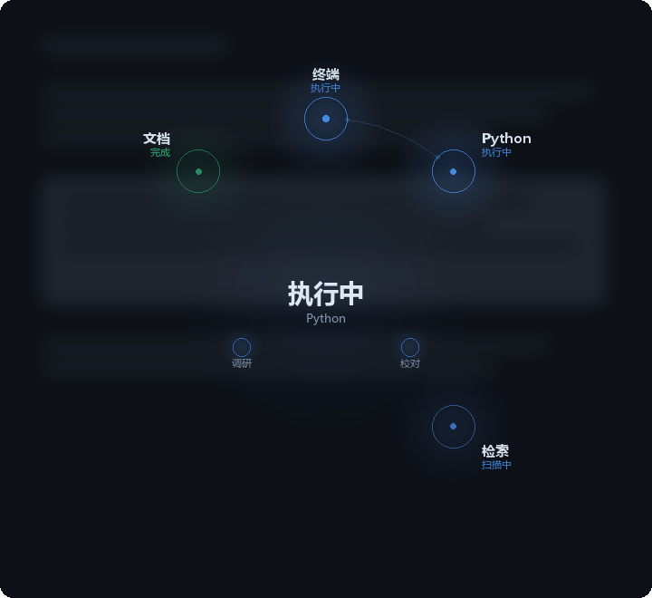
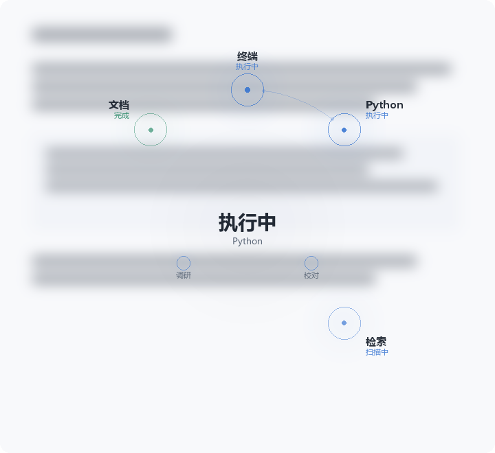
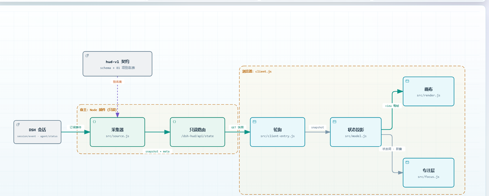

# DSH HUD — focus view

**Know what your agent is doing, at a glance.**

[中文](README.zh.md) · [Changelog](CHANGELOG.md) · [How it works](#how-it-works) · [Settings](#settings) · [Troubleshooting](#troubleshooting) · [Download the DSH-LLSA combined kit](https://github.com/TaoruiLiu19/DSH-LLSA/releases/latest)

[](https://www.npmjs.com/package/@dsh-llsa/hud)
[](https://www.npmjs.com/package/@dsh-llsa/hud)
[](LICENSE)
[](package.json)
[](#development)
[](package.json)
[](https://github.com/awesome-dsh-plugin/awesome-dsh-plugin/blob/main/README.md#L1837)

<p align="center">
  
  
</p>

<p align="center"><sub>Renders of the real geometry and palette, not screenshots of a running app</sub></p>

A read-only overlay for a DeepSeek Harness conversation. The centre says what the run is doing; fixed seats around the ring say what it is touching; a second line names the object. It exists for the two minutes you spend wondering *is it stuck, or still working?*

**It never calls a model, never writes a file, and never spends a token of its own.** It reads events and draws. A run you are watching still costs exactly what it cost before.

## Why this one

- **One glance, not a log.** Seven state words (`执行中` / `计划中` / `思考中` / `停顿中` / `等你确认` / `成功` / `失败` / `待命`) in the centre, and activity on a ring that **does not re-flow**: a seat is pinned to an angle, so a new material does not make the whole field jump.
- **Silent when it has nothing to say.** Unknown tools fall into one catch-all seat; bookkeeping (todos, goals, schedules) lights nothing at all and the centre says `计划中` instead. The HUD never invents a state it cannot see.
- **Read-only by construction.** One GET, one snapshot, no writes, no approvals, no delegation. The Host half derives two hints (a language, a material) from a call's own arguments and forwards neither.
- **Checks, not promises.** 122 tests, a contract fixture replay, a bundle-drift check, and `prepublishOnly` runs the same gate.

## Install

Requires **Node.js 24.11+** and a working **DeepSeek Harness Web**. The HUD is an optional bundle; installing it does not require building the rest of the workspace.

1. Open **Plugins** in the Harness sidebar.
2. Under install-bundle, paste the package name:

   ```text
   @dsh-llsa/hud
   ```

   Installing from a source checkout works too — paste the full path to `packages/hud` instead, and edits to `client.js` hot-replace:

   ```text
   D:/projects/DSH-LLSA/packages/hud
   ```

3. If the installer asks for a restart, restart the Harness and refresh the browser.

Sessions that expose a `plugin_manager` tool can ask it to run `install_bundle` with the same spec. Installation applies to the current Harness profile.

> The root `npm start` of DSH-LLSA does not enable the HUD, and the combined build does not include it. `npm install @dsh-llsa/hud` at the repo root only puts it in a `node_modules` — install it through the plugin page so the Harness actually loads it.

## What you see

| Where | What it tells you |
|---|---|
| **Centre** | The run's state, plus the object it is working on (`执行中 / Python`) |
| **Ring** | Six materials — terminal, code, search, documents, web, other — each in a fixed seat |
| **Inner ring** | Sub-agents and their states; only drawn when more than one agent is running |
| **Capsule** | After you leave the field, the pill in the corner re-opens it |

A material node has three readable properties: **colour** (blue in use, amber waiting on you, red failed, green done), **motion** (breathing while running, still once finished), and **words** (`编写中`, `阅读中`, `扫描中`, `完成` …).

The run and the material speak different vocabularies on purpose: `成功` / `失败` describe the **run**; `完成` describes **one material**. The green in the centre is a run verdict, not a correctness claim.

## States

| Shown | Meaning |
|---|---|
| 执行中 | Handling a tool or material |
| 计划中 | Doing bookkeeping (todos, goals, schedules); draws no material |
| 思考中 | Running, with no tool activity to show — not a replay of hidden reasoning |
| 停顿中 | The Host marked a running agent as silent past its threshold; not the same as failed |
| 等你确认 | Something needs you — a question is open |
| 成功 / 失败 | The run's outcome |

A question turns the field amber; answering it, or the turn ending, returns it to `执行中` / `成功` within a fraction of a second.

## How it works

<picture>
  <source media="(prefers-color-scheme: dark)" srcset="docs/hud-architecture-dark.png">
  
</picture>

<p align="center"><sub>Interactive version: <a href="docs/hud-runtime.html">docs/hud-runtime.html</a> — dark/light toggle, route highlighting, image export</sub></p>

One read-only path, no second one:

- **Host half** subscribes to `session/event`, `agent/status` and `subagent/*`, and folds them into a single `hud-v1` snapshot. Tool arguments are used locally to derive two enums (an interpreter language and a material override) and are never forwarded.
- **Browser half** issues one `GET /dsh-hud/api/state`, folds the snapshot into a view, and redraws on a canvas. Each frame only advances alpha, heat and pulses — it never recomputes state.
- **The contract** is the whole interface: eight fixed fields, `additionalProperties: false`, and an alias table mirrored one-to-one. Derived hints ride outside the contract in `meta`, which is why adding them did not change the protocol.

## Themes

The field follows the host's surface instead of assuming a dark window. It reads the luminance of the first painted ancestor of the conversation column: brighter than 0.5 is a light theme, and the whole palette inverts — pale scrim, dark ink, deeper accents, weaker glows, stronger hairlines. Switching the shell's theme repaints on the next frame.

If a theme paints its conversation with an image or gradient rather than a colour, the probe walks to the end and falls back to `prefers-color-scheme`.

## Limits

- **One session at a time** — the focused one. There is no all-sessions wallboard.
- **Core event mode** shows a sub-agent's state and short label but not its own tool activity, and does not treat approvals as attention. A compatible external snapshot (`hudEndpoint`) does.
- **The arc between terminal and code** is one pre-set relation lit by a declared execution. It is not a call graph, a network trace, or a token meter.
- **Material failure is not observable.** A failed run says `失败` and that earlier results were kept; it does not name the step, because the HUD does not read tool output.
- `stalled` is decided by the Host, never by the browser's own clock.

## Settings

Open the plugin's settings form in the Harness plugin page.

| Option | Default | Purpose |
|---|---|---|
| `focusMode` | `true` | Enables the focus layer; off means no overlay, capsule or hint |
| `hudEndpoint` | `""` | Optional external `hud-v1` snapshot URL; leave empty for normal use |
| `hudTimeoutMs` | `900` | Timeout for that external request, in ms |
| `maxSessions` | `32` | Sessions the collector keeps; not how many are displayed |
| `childrenRefreshMs` | `1200` | Cache time for the sub-agent list, in ms |

Keys: `Esc` or clicking the blank area leaves the field; the corner capsule returns; `Ctrl/Cmd+Shift+H` hides it for the current page without saving; turning `focusMode` off turns it off for good.

## Troubleshooting

| Symptom | What to check |
|---|---|
| No overlay after install | The profile has the bundle enabled and `focusMode` is on; start a new run, and check you did not hide it with the shortcut |
| Briefly missing at startup | The Host is registering the route; it retries instead of reporting offline on the first failure |
| “HUD 未连接” stays | You are on the instance that has the plugin; refresh; check `/dsh-hud/api/ping` |
| Sub-agent has no tool animation | Core mode shows its state and label only |
| A tool lands in “其它” | It has no material mapping, or the snapshot's alias version differs |
| Too dim on a light theme | The palette follows the measured background; a background image can defeat the probe |
| Exact tokens and cost | Use `/collab` in DSH-LLSA; the HUD does not do billing |

`/dsh-hud/api/ping` reports the **snapshot protocol** version (1), not the package version. Keep your local auth; do not paste authenticated links into issues.

## Development

No model API is needed for any of this:

```sh
node packages/hud/scripts/build-client.mjs --check   # the committed bundle matches src/
node packages/hud/scripts/run-tests.mjs              # 122 tests, no child processes
```

After editing browser sources, rebuild and re-check:

```sh
node packages/hud/scripts/build-client.mjs
node packages/hud/scripts/build-client.mjs --check
node packages/hud/scripts/run-tests.mjs
```

or `npm run check --prefix packages/hud`. Tests read the repository's [contract fixtures](../../contracts/fixtures/), so the full checkout is the recommended place to run them.

| Path | Responsibility |
|---|---|
| `src/index.js`, `src/source.js` | Host routes, event collection, snapshot |
| `src/model.js`, `src/materials.js` | State projection, materials, fixed seats, palettes |
| `src/render.js`, `src/focus.js` | Canvas drawing, focus layer, capsule, theme probe |
| `src/client-entry.js` | Session switching, polling, slot registration |
| `src/labels.js` | Display-name sanitising and length caps |
| `client.js` | Generated browser artifact — always rebuild, never edit |
| `docs/` | README figures, the interactive diagram, and its JSON source |

Protocol: [hud-v1 schema](../../contracts/hud-v1.schema.json). Tool IDs stay native; the alias table is separate from the material taxonomy. Nothing here records or reconstructs hidden model reasoning.

## License

[MIT](LICENSE). Third-party notices in [NOTICE](NOTICE).
