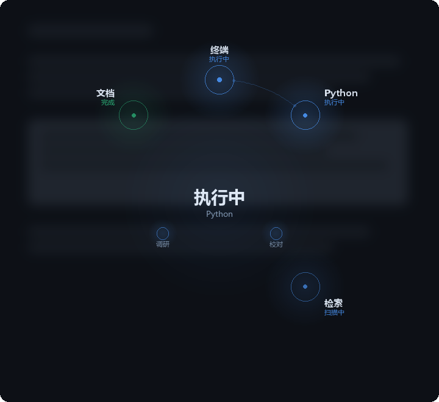
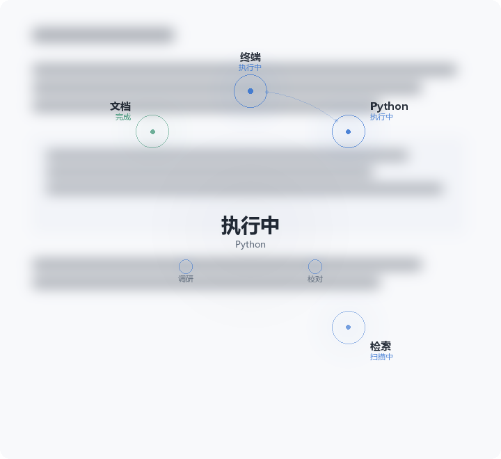
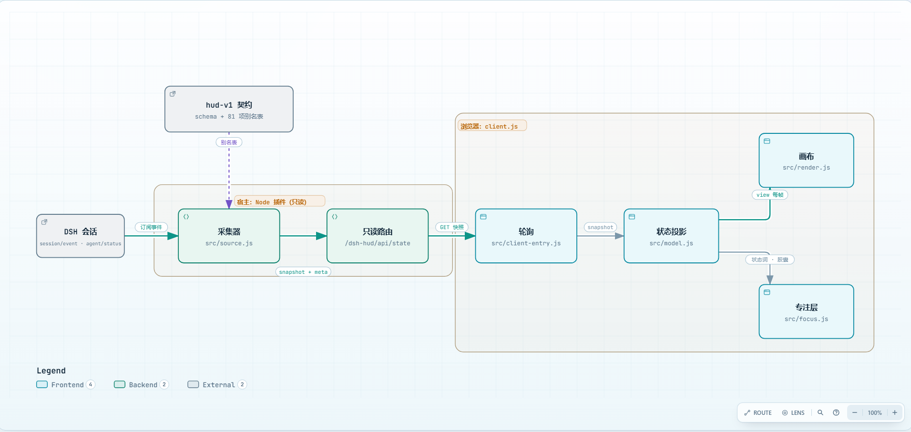

# HUD 专注视图

**Agent 在忙什么，抬眼就能看懂。**

<p align="center">
  
  
</p>

<p align="center"><sub>图为按插件同一套几何与调色板离线渲染的示意，不是运行截图</sub></p>

为 DeepSeek Harness Web 提供实时状态浮层：中心显示任务状态，外圈显示正在使用的工具类别，中间一层显示子 Agent。适合等待长任务、观察多智能体协作，以及及时发现需要你回复的问题。

[返回 DSH-LLSA](../../README.md) · [更新记录](CHANGELOG.md) · [它是怎么工作的](#它是怎么工作的) · [配置选项](#配置选项) · [常见问题](#常见问题)

## 一眼看懂协作现场

| 看哪里 | 你能知道什么 |
|---|---|
| **中心状态** | 执行中、计划中、思考中、停顿中、等你确认、成功、失败或待命；必要时附上 Python 等对象名 |
| **外圈材料** | 终端、代码、检索、文档、网页、其它六类活动；位置固定，节点增减不会让整圈跳位 |
| **子 Agent 圈** | 当前快照中的子 Agent 与状态；只有存在多个 Agent 时才出现 |
| **返回胶囊** | 退出浮层后，点击消息区的胶囊重新查看 |

节点由实际事件驱动。执行时有呼吸动效，等待确认时停止呼吸；状态同时使用文字和颜色表达。中心的“成功”表示运行结束状态，不代表结果已经通过业务正确性验证。

**主题跟随宿主。** 浮层不假定你在深色模式下工作：它读取界面背景的实际亮度，浅色主题下换成白色磨砂遮罩、深色文字和更重的强调色，切主题时下一帧就重画。上面两张图是同一块场在两套主题下的样子。

> **HUD 本身不调用模型，也不消耗模型 token。** 它读取状态并绘图，不修改任务、不派发 Agent，也不执行审批。正在观察的任务仍会产生原有模型费用。节省通信成本由 [LeanLink](../../README.md#认识-leanlink) 负责，HUD 当前不展示节省金额。

## 安装与第一次使用

需要 **Node.js 24.11+**，以及已能正常打开的 **DeepSeek Harness Web**。本仓库使用 Harness `0.2.2-rc.1`；HUD 是独立的可选 bundle，当前包版本见 [package.json](package.json)。

### 1. 获取源码目录

已有 DSH-LLSA 仓库时，在仓库根目录运行 `git pull`。首次获取：

```sh
git clone https://github.com/TaoruiLiu19/DSH-LLSA.git
cd DSH-LLSA
```

HUD 所在目录为 `packages/hud`。仓库已包含生成好的 `client.js`，仅安装 HUD 无需先构建整个工作台，也无需把它发布到 npm。

### 2. 在正在使用的 Harness 中安装 bundle

打开 Harness Web 侧边栏的 **插件** 页面，通过安装组合包入口，提供 `packages/hud` 的**完整本地路径**，安装并启用。例如：

```text
D:/projects/DSH-LLSA/packages/hud
```

把示例换成自己的真实路径。支持 `plugin_manager` 工具的会话也可以请求它通过 `install_bundle` 安装这个目录；若当前预设没有该工具，使用插件页面。安装器若返回需要重启，重启当前 Harness，再刷新浏览器。

安装作用于当前 Harness profile。应在自己实际使用的实例中操作；不要只在仓库根目录执行 `npm install @dsh-llsa/hud`，该包未承诺发布到 npm。

**发行包说明：** DSH-LLSA 的根目录 `npm start` 不会自动启用 HUD；当前组合构建包也未打入 HUD。请从完整源码目录单独安装本 bundle。它显示在 Harness 的会话界面，不是 `/collab` 或 `/orchestrator/local` 页面里的内嵌组件。

### 3. 观察一次任务

在 Harness 会话里发送正常任务，例如：

> 检查当前项目的 package.json，告诉我有哪些测试命令。先不要运行测试，也不要修改文件。

任务开始后观察浮层和工具节点。这个例子只验证显示入口；实际能否读取文件取决于该会话的工具和权限。

- **退出浮层：** 按 `Esc` 或点击浮层空白处。
- **重新打开：** 点击消息区右下角的状态胶囊。
- **临时隐藏／恢复：** `Ctrl+Shift+H`；macOS 使用 `Cmd+Shift+H`，只影响当前页面。
- **长期关闭：** 在插件设置里关闭 `focusMode`。
- **需要回复时：** 查看“等你确认”提示，在 Harness 原生问答界面回复。已经主动关闭的浮层不会因为提问而强行重开。

## 它是怎么工作的

<picture>
  <source media="(prefers-color-scheme: dark)" srcset="docs/hud-architecture-dark.png">
  
</picture>

<p align="center"><sub>交互版：<a href="docs/hud-runtime.html">docs/hud-runtime.html</a>（可切换明暗与动效，按路径高亮，也能导出图片）</sub></p>

一条只读的链路，没有第二条：

- **宿主半边**只订阅 `session/event`、`agent/status`、`subagent/*`，把它们折成一份 `hud-v1` 快照。工具参数只在本机用来推导类别（解释器语言、源码扩展名），**命令原文与路径从不转发给浏览器**。
- **浏览器半边**发一次只读 `GET /dsh-hud/api/state`，把快照投影成视图；绘制每帧只改透明度、热度与脉冲，不重算状态。
- **契约**是唯一接口：快照 8 个固定字段、`additionalProperties: false`，别名表 81 项与契约逐条镜像。派生信息（语言、材料覆盖）走契约之外的 `meta`，因此加它们不需要改协议。

## 状态与显示边界

| 显示 | 含义 |
|---|---|
| 执行中 | 正在处理工具或材料 |
| 计划中 | 当前进行待办、目标等计划管理；不另画材料节点 |
| 思考中 | 运行中，当前没有可展示的工具活动；不是模型内部推理的回放 |
| 停顿中 | 服务端标记运行中的 Agent 超过静默阈值；不等于已经故障 |
| 等你确认 | 存在需要用户处理的等待状态 |
| 成功／失败 | 本轮运行的完成状态 |

代码文件可归入“代码”节点；受支持的终端解释器命令可产生代码执行提示。无法识别的复杂命令不会猜测语言。未知工具归入“其它”。节点连线是预设的活动关系，**不是完整调用链、网络流量图或 token 传输计量图**。

HUD 只展示当前会话，不把所有工单同时聚合到一个全局视图。

## 配置选项

在 Harness 插件页面打开本插件的设置表单。

| 选项 | 默认值 | 用途 |
|---|---|---|
| `focusMode` | `true` | 启用专注浮层；关闭后不显示浮层、胶囊和提示 |
| `hudEndpoint` | 空字符串 | 可选的外部 `hud-v1` 快照地址；普通使用保持为空 |
| `hudTimeoutMs` | `900` | 外部快照请求超时，单位毫秒 |
| `maxSessions` | `32` | 采集器最多保留的会话数量；不是同时展示数量 |
| `childrenRefreshMs` | `1200` | 子 Agent 列表缓存时间，单位毫秒 |

默认从 Harness 会话事件生成快照，不要求安装 Super-agent。仅在已有兼容接口时配置 `hudEndpoint`：其中 `{session}` 会替换为 URL 编码的会话 ID，接口必须能将它映射到正确的运行。不要把会话 ID 直接假定为工单 runId。外部接口不可用、超时或数据格式不兼容时，回退到核心事件。

核心事件模式能够展示用户提问等待，但不覆盖审批请求；子 Agent 的工具事件也不会全部合并到主会话材料圈。若需要完整编排状态，须由兼容的外部快照提供。快照里的 `stalled` 由服务端决定，浏览器不自行根据等待时长修改状态。

## 常见问题

| 现象 | 排查方式 |
|---|---|
| 安装后没有出现浮层 | 确认当前 profile 已启用 bundle、`focusMode` 为开启；刷新后发起一次任务，检查是否曾用快捷键隐藏 |
| 启动时短暂未显示 | 等待 Web 服务注册；插件会重试连接，不会把首次请求失败立即判为离线 |
| 一直显示“HUD 未连接” | 确认访问的是安装插件的 Harness 实例，刷新页面；检查宿主日志及 `/dsh-hud/api/ping` 是否可访问 |
| 子 Agent 没有工具动画 | 核心事件模式只展示它的状态和短名，不合并所有子会话工具事件 |
| 某个工具落入“其它” | 工具没有材料映射，或快照的别名版本不匹配；基础状态仍可显示 |
| 浅色主题下颜色偏淡 | 浮层按界面背景亮度自动选色板；若宿主用背景图而非纯色，探测可能退回系统偏好 |
| 想看准确 token 和费用 | 使用 DSH-LLSA 的 `/collab` 用量视图；HUD 不做账单统计 |

`/dsh-hud/api/ping` 中的 `version` 是快照协议版本 **1**，不是 HUD 包版本。请保留本机认证，不要在反馈中分享认证链接或密钥。

## 开发与验证

在完整仓库根目录运行，HUD 检查本身无需模型 API：

```sh
node packages/hud/scripts/build-client.mjs --check
node packages/hud/scripts/run-tests.mjs
```

修改浏览器源码后重新生成，再验证：

```sh
node packages/hud/scripts/build-client.mjs
node packages/hud/scripts/build-client.mjs --check
node packages/hud/scripts/run-tests.mjs
```

也可以使用 `npm run check --prefix packages/hud`。当前通过 **117 项测试**，覆盖契约夹具回放、问答等待恢复、会话切换、固定席位布局、路径脱敏、文件工具事件、取消后的执行状态清理，以及浅色/深色调色板。测试数量以后续命令输出为准；这些自动化检查不能替代所有浏览器环境的人工体验验证。

测试读取仓库的 [契约夹具](../../contracts/fixtures/)；只有单独 package 的副本可能跳过回放，因此完整仓库是推荐验证环境。

| 文件 | 职责 |
|---|---|
| `src/index.js`、`src/source.js` | 宿主只读路由、事件采集和快照 |
| `src/model.js`、`src/materials.js` | 状态投影、材料分类、固定席位与调色板 |
| `src/render.js`、`src/focus.js` | 绘制、专注浮层、返回胶囊、主题探测 |
| `src/client-entry.js` | 会话切换、轮询、界面入口 |
| `src/labels.js` | 展示短名脱敏与长度限制 |
| `client.js` | 已生成的浏览器产物，请通过构建脚本更新 |
| `docs/` | README 用的图，以及架构图的可交互版本与它的源规格 |

协议使用 [hud-v1 schema](../../contracts/hud-v1.schema.json)，工具保留原生 ID，别名表与材料分类分离。工具参数只在宿主侧用于推导类别，不转发原始命令和路径；HUD 不提供模型隐藏推理的记录。

## 许可

[MIT](LICENSE)。第三方说明见 [NOTICE](NOTICE)。
