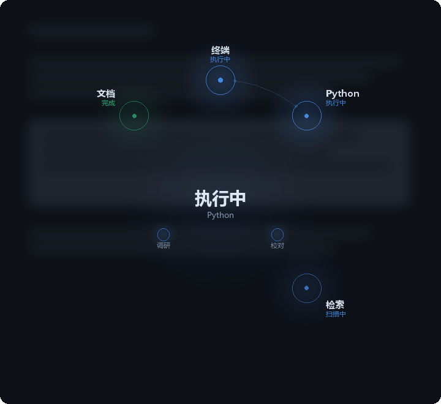
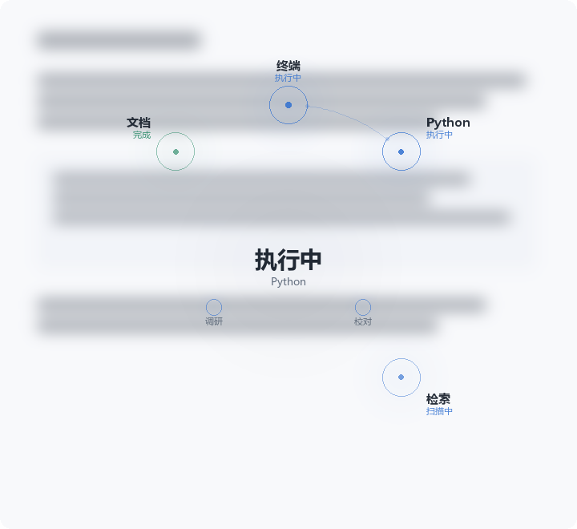
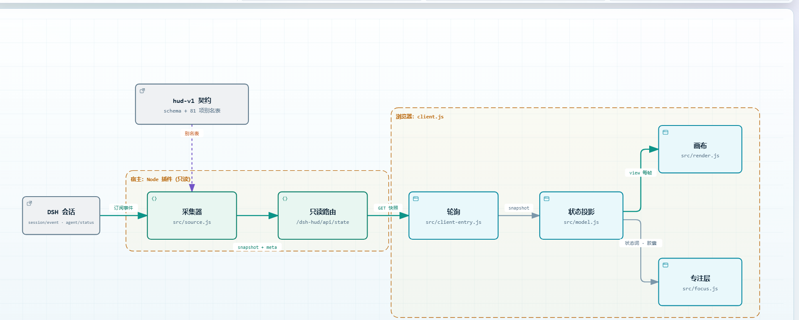

# DSH HUD 专注视图

**Agent 在忙什么，抬眼就能看懂。**

[English](README.md) · [更新记录](CHANGELOG.md) · [它是怎么工作的](#它是怎么工作的) · [配置选项](#配置选项) · [常见问题](#常见问题) · [下载 DSH-LLSA 组合包](https://github.com/TaoruiLiu19/DSH-LLSA/releases/latest)

[](https://www.npmjs.com/package/@dsh-llsa/hud)
[](https://www.npmjs.com/package/@dsh-llsa/hud)
[](LICENSE)
[](package.json)
[](#开发与验证)
[](package.json)
[](https://github.com/awesome-dsh-plugin/awesome-dsh-plugin/blob/main/README.zh.md#L1837)

<p align="center">
  
  
</p>

<p align="center"><sub>图为按插件同一套几何与调色板离线渲染的示意，不是运行截图</sub></p>

一个只读的状态浮层，盖在 DeepSeek Harness 的会话上：中心一行状态词说这一轮在干什么，外圈固定席位说它在用什么，第二行点出具体对象。它解决的是那两分钟里你反复问自己的问题——**它是卡住了，还是在干活**。

**它不调用模型、不写文件、不消耗自己的 token。** 只读事件、只画图；你正在观察的任务，费用一分不变。

## 为什么是它

- **一眼，不是日志。** 中心只有七个状态词（执行中 / 计划中 / 思考中 / 停顿中 / 等你确认 / 成功 / 失败 / 待命），活动显示在**不会重排**的环上：每个席位钉在固定角度，来了新活动也不会让整圈跳位。
- **没东西可说时保持安静。** 不认识的工具归进一个「其它」座位；待办、目标、定时这类记账工具**一个节点都不画**，中心改说「计划中」。它不会编一个自己看不见的状态。
- **只读是构造出来的，不是承诺。** 一条 GET、一份快照、零写入、零审批、零派生。宿主半边只从调用的参数里推导两个枚举（语言、材料），**原文从不转发**。
- **检查，不是保证。** 122 条测试、契约夹具回放、bundle 漂移检查，`prepublishOnly` 跑同一套门禁。

## 安装

需要 **Node.js 24.11+**，以及能正常打开的 **DeepSeek Harness Web**。HUD 是独立的可选 bundle，装它不需要构建整个工作台。

1. 打开 Harness 侧边栏的 **插件** 页面。
2. 在安装组合包入口填包名：

   ```text
   @dsh-llsa/hud
   ```

   也可以填源码目录的**完整路径**，开发时更方便——改 `client.js` 会热替换：

   ```text
   D:/projects/DSH-LLSA/packages/hud
   ```

3. 安装器若提示需要重启，重启 Harness，再刷新浏览器。

有 `plugin_manager` 工具的会话可以直接让它用同样的 spec 跑 `install_bundle`。安装作用于当前 Harness profile。

> DSH-LLSA 根目录的 `npm start` 不会启用 HUD，组合构建包也没有打入它；在仓库根执行 `npm install @dsh-llsa/hud` 只是把包装进某个 `node_modules`。请从插件页安装，宿主才会真正加载它。

## 一眼看懂协作现场

| 看哪里 | 你能知道什么 |
|---|---|
| **中心** | 这一轮的状态，以及它正在处理的对象（`执行中 / Python`） |
| **外圈** | 六类材料——终端、代码、检索、文档、网页、其它——各有固定席位 |
| **内圈** | 子 Agent 及其状态；只有存在多个 Agent 时才画 |
| **胶囊** | 退出浮层后，点右下角的胶囊重新打开 |

一个材料节点有三个可读属性：**颜色**（蓝=在用，琥珀=卡在你，红=出错，绿=完成）、**动效**（运行中呼吸，完成后静止）、**用词**（`编写中`、`阅读中`、`扫描中`、`完成`……）。

整轮和材料的词表是**故意分开**的：`成功` / `失败` 说的是**这一轮**，`完成` 说的是**某一个材料**。中心的绿色是运行结论，不是业务正确性验证。

## 状态与显示边界

| 显示 | 含义 |
|---|---|
| 执行中 | 正在处理工具或材料 |
| 计划中 | 正在做待办、目标、定时这类记账工作；不画材料节点 |
| 思考中 | 运行中，当前没有可展示的工具活动；不是隐藏推理的回放 |
| 停顿中 | 服务端把运行中的 Agent 标记为超过静默阈值；不等于故障 |
| 等你确认 | 有事需要你——有提问还开着 |
| 成功／失败 | 这一轮的结论 |

提问会让场变琥珀；你回答之后、或这一轮结束，它会在零点几秒内回到「执行中 / 成功」。

## 它是怎么工作的

<picture>
  <source media="(prefers-color-scheme: dark)" srcset="docs/hud-architecture-dark.png">
  
</picture>

<p align="center"><sub>交互版：<a href="docs/hud-runtime.html">docs/hud-runtime.html</a>——可切换明暗、按路径高亮、导出图片</sub></p>

一条只读的链路，没有第二条：

- **宿主半边**订阅 `session/event`、`agent/status`、`subagent/*`，折成一份 `hud-v1` 快照。工具参数只在本机用来推导两个枚举（解释器语言、材料覆盖），**命令原文与路径从不转发**。
- **浏览器半边**发一次 `GET /dsh-hud/api/state`，把快照投影成视图，再画到 canvas。每一帧只推进透明度、热度与脉冲，不重算状态。
- **契约**就是全部接口：八个固定字段、`additionalProperties: false`、别名表逐条镜像。派生信息走契约之外的 `meta`，所以加它们不需要改协议。

## 主题跟随

场不假定你在深色模式下工作。它读取会话列**第一个真正绘制背景的祖先**的亮度：高于 0.5 判为浅色，整套调色板随之反转——浅色遮罩、深色文字、更深的强调色、更弱的光晕、更实的细线。切宿主主题，下一帧就重画。

如果某个主题用图片或渐变绘制对话区（`background-color` 透明），探测会一路走到头，退回 `prefers-color-scheme`。

## 已知边界

- **一次只看一个会话**——当前聚焦的那个，没有全量看板。
- **核心事件模式**能显示子 Agent 的状态和短名，但不合并它自己的工具活动，也不把审批算作「等你确认」。接上兼容的外部快照（`hudEndpoint`）才有完整编排状态。
- **终端与代码之间的弧**是一条由「已声明的执行」点亮的预置关系，不是调用链、网络流量图或 token 计量图。
- **材料级失败不可观测。** 失败时中心说「失败」，并提示前面的结果已保留，但不会指出是哪一步——因为 HUD 不读工具输出。
- `stalled` 由服务端决定，浏览器绝不按自己的时钟改状态。

## 配置选项

在 Harness 插件页打开本插件的设置表单。

| 选项 | 默认值 | 用途 |
|---|---|---|
| `focusMode` | `true` | 启用专注浮层；关闭后不显示浮层、胶囊和提示 |
| `hudEndpoint` | 空字符串 | 可选的外部 `hud-v1` 快照地址；普通使用保持为空 |
| `hudTimeoutMs` | `900` | 外部快照请求超时，单位毫秒 |
| `maxSessions` | `32` | 采集器最多保留的会话数量；不是同时展示数量 |
| `childrenRefreshMs` | `1200` | 子 Agent 列表缓存时间，单位毫秒 |

快捷键：`Esc` 或点空白处退出浮层，右下角胶囊可以再进来；`Ctrl/Cmd+Shift+H` 只对当前页面隐藏、不写入设置；把 `focusMode` 关掉才是长期关闭。

## 常见问题

| 现象 | 排查方式 |
|---|---|
| 安装后没有出现浮层 | 确认当前 profile 已启用 bundle、`focusMode` 为开启；刷新后发起一次任务，检查是否曾用快捷键隐藏 |
| 启动时短暂未显示 | 宿主正在注册路由；它会重试，不会把首次失败判成离线 |
| 一直显示「HUD 未连接」 | 确认访问的是装了这个插件的实例，刷新页面，检查 `/dsh-hud/api/ping` |
| 子 Agent 没有工具动画 | 核心事件模式只展示它的状态和短名 |
| 某个工具落入「其它」 | 工具没有材料映射，或快照的别名版本不匹配 |
| 浅色主题下颜色偏淡 | 调色板跟的是实测背景；宿主用背景图片时探测可能失效 |
| 想看准确 token 和费用 | 使用 DSH-LLSA 的 `/collab` 用量视图；HUD 不做账单统计 |

`/dsh-hud/api/ping` 里的 `version` 是**快照协议**版本（1），不是包版本。请保留本机认证，不要把带认证的链接贴进 issue。

## 开发与验证

下面这些都不需要模型 API：

```sh
node packages/hud/scripts/build-client.mjs --check   # 提交的 bundle 与 src/ 一致
node packages/hud/scripts/run-tests.mjs              # 122 条测试，不 spawn 子进程
```

改完浏览器侧源码要重建再验：

```sh
node packages/hud/scripts/build-client.mjs
node packages/hud/scripts/build-client.mjs --check
node packages/hud/scripts/run-tests.mjs
```

或 `npm run check --prefix packages/hud`。测试会读仓库的[契约夹具](../../contracts/fixtures/)，所以推荐在完整仓库里跑。

| 路径 | 职责 |
|---|---|
| `src/index.js`、`src/source.js` | 宿主只读路由、事件采集、快照 |
| `src/model.js`、`src/materials.js` | 状态投影、材料分类、固定席位、调色板 |
| `src/render.js`、`src/focus.js` | canvas 绘制、专注层、返回胶囊、主题探测 |
| `src/client-entry.js` | 会话切换、轮询、插槽注册 |
| `src/labels.js` | 展示短名脱敏与长度限制 |
| `client.js` | 已生成的浏览器产物——只通过构建脚本更新，不要手改 |
| `docs/` | README 用的图、可交互架构图与它的 JSON 源规格 |

协议见 [hud-v1 schema](../../contracts/hud-v1.schema.json)。工具保留原生 ID，别名表与材料分类分离。HUD 不做模型隐藏推理的记录或重建。

## 许可

[MIT](LICENSE)。第三方说明见 [NOTICE](NOTICE)。
