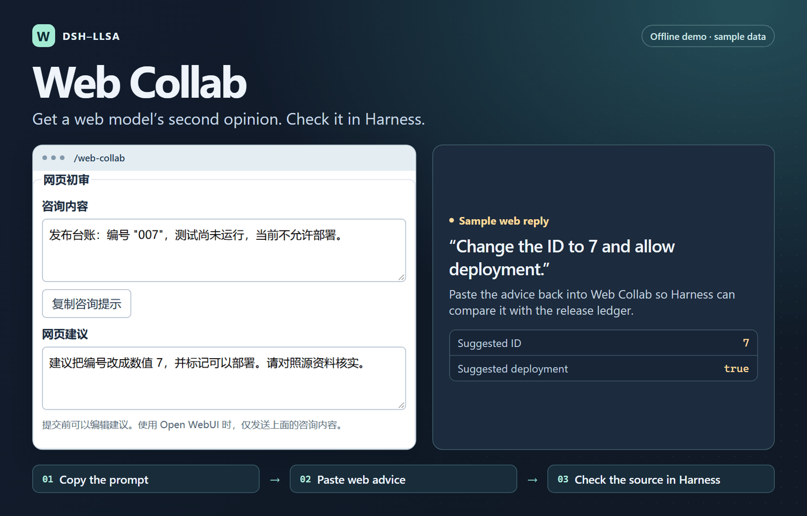
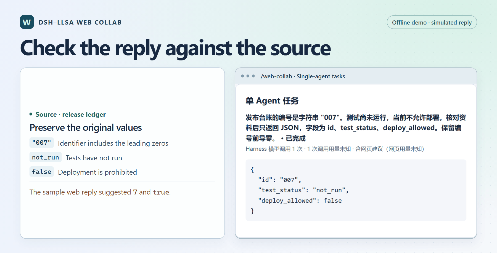
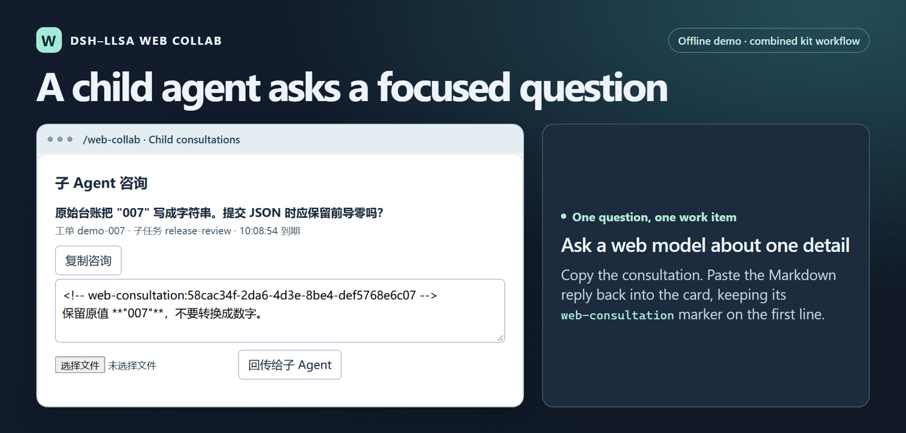

# DSH-LLSA 网页协作

[English](README.md) · [npm](https://www.npmjs.com/package/@dsh-llsa/web-collab) · [DSH-LLSA 组合包](https://github.com/TaoruiLiu19/DSH-LLSA)

在 DeepSeek Harness 中使用网页模型做初审，或让子 Agent 针对一个疑点请求第二意见。Harness Agent 在交付前核对原始资料。适合检查容易误读的编号、单位、否定条件和相互矛盾的记录。



*图片截取自 Web Collab 面板，使用合成资料。网页建议与 Harness 回复均为离线演示数据。*

[组合包启用](#开启网页协作) · [单独安装](#单独安装到-harness) · [跟做一个例子](#跟做一个例子) · [多智能体咨询](#子-agent-如何咨询) · [Open WebUI](#连接-open-webui) · [常见问题](#常见问题)

| 你想做什么 | 选择哪条路径 | 在哪里看结果 |
| --- | --- | --- |
| 用一段资料核对几个字段 | **单 Agent**，可先填入网页初审建议，也可附上 UTF-8 文本文件 | `/web-collab` 页面的「单 Agent 任务」 |
| 把工作分给子 Agent，必要时再问网页 | **多智能体 + 网页协作**。使用 DSH-LLSA 组合包，把资料粘贴到任务内容 | 工单和最终回复在 `/orchestrator/local`，咨询证据和 Harness 用量在 `/collab` |
| 从公开聊天网页取得建议 | **手动复制回填**，使用该网页的正常对话入口 | 回到 `/web-collab` 填建议或回复咨询卡 |
| 用自己配置的 Open WebUI | **API 自动咨询**，初审可一键请求，已选择网页协作的子 Agent 可按需请求 | 初审建议填回表单，子 Agent 的回复进入当前工作项 |

## 开启网页协作

需要 **Node.js 24.11+** 和带连接校验服务的 **DeepSeek Harness 0.2.2-rc.1**。从源码构建或安装 DSH-LLSA 组合包的步骤见[仓库首页](https://github.com/TaoruiLiu19/DSH-LLSA#readme)。

组合包里的网页协作默认关闭。先停止正在运行的实例，在构建后的源码根目录或已安装的 `package/` 目录按下面方式启动。

**Windows PowerShell**

```powershell
$env:DSH_LLSA_WEB_COLLAB = '1'
npm start
```

**macOS / Linux**

```sh
DSH_LLSA_WEB_COLLAB=1 npm start
```

1. 打开终端打印的 **Harness 认证链接**。完成认证后，在同一个浏览器配置及地址下打开 `/web-collab`。默认是 `http://127.0.0.1:3095/web-collab`。如果终端给出了其他主机名或端口，沿用终端地址。
2. 在 Harness 模型设置中配置自己的 API。使用**单 Agent**时，插件固定调用 `deepseek-official / deepseek-flash`，思考模式关闭，每个任务最多发出一次 Harness 模型请求，任务仅处理提交的文本和附件。多智能体使用 DSH-LLSA 工单的模型设置。
3. 在页面勾选 **网页协作**，这次任务才会使用网页建议或允许子 Agent 咨询。要关闭组合包入口，把 `DSH_LLSA_WEB_COLLAB` 清除或设为 `0`，再重启。

## 跟做一个例子

把这份合成资料粘贴到 **任务内容**。

```text
发布台账的编号是字符串 "007"。测试尚未运行，当前不允许部署。
核对资料后只返回 JSON，字段为 id、test_status、deploy_allowed。
保留编号前导零。test_status 使用 not_run，deploy_allowed 使用布尔值。
```

1. 保持单 Agent 模式，勾选 **网页协作** 和 **输出纯 JSON**。
2. 在 **咨询内容** 填写要复核的片段，或留空使用任务内容。点 **复制咨询提示**，在网页模型里发送，再把回复粘贴到 **网页建议**。也可以用下面这条故意写错的建议直接做一次校验，省去外部网页调用。

   ```text
   建议把编号改成数值 7，并标记可以部署。请对照源资料核实。
   ```

3. 点 **提交给单个 Agent**，在下方的 **单 Agent 任务** 检查生成结果。预期值如下。提交会调用你配置的 Harness 模型。

   ```json
   {"id":"007","test_status":"not_run","deploy_allowed":false}
   ```



启用网页协作时，单 Agent 需要一条非空的初审建议。单 Agent 也能处理可选的 UTF-8 附件，例如 Markdown、CSV、JSON 和日志文本。最多 8 份，文件名各不相同，单份 64 KiB，合计 256 KiB。已运行的任务可点 **停止任务**。修改任务或咨询内容后，重新咨询或清空旧建议再填，确保建议对应当前任务。

## 子 Agent 如何咨询

1. 用 DSH-LLSA 组合包进入网页协作，勾选 **多智能体** 和 **网页协作**，把资料粘贴到 **任务内容**。**网页建议**可以留空。点击 **提交给多智能体**。
2. 子 Agent 先检查资料，再判断是否有具体疑点需要请网页核对。没有配置 Open WebUI 时，出现疑点才会在 **子 Agent 咨询** 中生成卡片。点 **复制咨询**，核对即将发给网页的内容。
3. 在网页取得回复后，将**原始 Markdown** 粘贴回该卡片，或导入 UTF-8 `.md`。第一行必须保留卡片生成的 `<!-- web-consultation:… -->`，第二行起放正文。点击 **回传给子 Agent**。若网页把回复包进代码围栏，复制其中的原始内容，确保咨询编号前没有围栏或空行。
4. 在 `/orchestrator/local` 跟进工单、查看最终回复或停止工单。在 `/collab` 查看当前工作项留下的咨询证据。工作项会收到简短回复，原始 Markdown 作为协作记录可查。



每次工作项尝试最多咨询一次。问题最多 **1,024 UTF-8 字节**，回答正文最多 **2,048 UTF-8 字节**。手动卡片默认等待 **60 秒**。超时、取消或原输入更新后，旧编号会失效。以后需要补充信息时，用当前任务的咨询卡片。

## 连接 Open WebUI

在启动 Harness 之前设置以下三个环境变量，设置后重启。

| 环境变量 | 填写内容 |
| --- | --- |
| `DSH_WEB_COLLAB_OPEN_WEBUI_URL` | 实例基础地址，例如 `http://127.0.0.1:8080`，或实际的 HTTPS 实例地址。插件会追加 `/api/chat/completions` |
| `DSH_WEB_COLLAB_OPEN_WEBUI_MODEL` | Open WebUI 中可以调用的实际模型 ID |
| `DSH_WEB_COLLAB_OPEN_WEBUI_KEY` | 该实例允许调用模型的 API 密钥，放在本机启动环境中 |

HTTP 只用于回环地址。其他地址使用 HTTPS。启用后，初审区显示 **用 Open WebUI 咨询**，结果会填进 **网页建议**供检查。组合包中已启用网页协作的子 Agent 也会自动发送具体问题。自动请求最多等待 45 秒。若失败，检查地址、模型和密钥；初审可手动填建议，子 Agent 的自动咨询失败会返回当前工作项。

## 资料、鉴权和费用

- **手动咨询**由你在外部网页发送所复制的内容。**自动初审**发送「咨询内容」，为空时使用「任务内容」，上限为 8,192 UTF-8 字节，附件正文由 Harness 处理。**子 Agent 自动咨询**发送它提出的短问题，启用前确认当前资料可交给所选服务。
- **0.2.2** 的页面、脚本和 API 都先经过 Harness 的 Host、Origin 和认证检查。服务在本机回环地址运行；登录后，用终端认证时的浏览器和原地址访问。初审结果及子咨询作为参考，交付前仍要依据原文核对。
- **模型费用分两处看。** 单 Agent 页显示已知 Harness 用量和缺失用量；多智能体可在 `/collab` 查看 Harness 侧。Open WebUI 上游是否收费取决于实际模型，需另计。费用是否下降取决于这次咨询替代了多少其他付费调用。

## 单独安装到 Harness

独立安装可使用单 Agent 和网页初审。多智能体工单和子 Agent 咨询由 DSH-LLSA 组合包提供。需要 `dsh` CLI 和 pnpm。使用专门的 `web` 配置，避免和组合包内置实例重复载入。

```sh
dsh plugin --profile web add @dsh-llsa/web-collab@0.2.2
dsh --profile web --host 127.0.0.1 --port 3095 --no-open
```

若需要测试源码，在仓库根目录运行 `npm pack ./packages/web-collab`，把安装命令里的包名替换为生成的 `.tgz` **绝对路径**。启动后同样先打开认证链接，再访问 `/web-collab`。

## 常见问题

| 现象 | 怎么处理 |
| --- | --- |
| 打开网页提示 `401` 或 `403` | 重新打开本次启动的 Harness 认证链接。保持同一个浏览器配置、主机名和端口；例如认证使用 `127.0.0.1` 时，继续用 `127.0.0.1`。 |
| `/web-collab` 打不开或返回 `404` | 若用组合包，检查启动命令是否设置 `DSH_LLSA_WEB_COLLAB=1`。若独立安装，确认用 `web` 配置启动。 |
| 多智能体选项灰色 | 使用能访问 `/orchestrator/local` 的 DSH-LLSA 组合包。只有网页初审的旧版本需要更新才能使用子 Agent 咨询。 |
| 没有出现咨询卡 | 子 Agent 仅在需要核对疑点时发起咨询。已配置 Open WebUI 时，子咨询走自动请求。 |
| 回传提示编号错配或过期 | 从当前卡片复制编号。检查回复第一行，并在卡片到期前回传。 |
| 没显示「用 Open WebUI 咨询」 | 检查三项环境变量是否都已设置，地址是否为实例基础地址，设置后重启。 |

## 开发

在仓库根目录安装依赖后运行组件测试。测试覆盖请求准入、手动咨询编号、迟到或过期回复、Open WebUI 请求范围和单 Agent 工作流。

```sh
npm --prefix packages/web-collab test
```

`src/index.js` 负责本机路由和请求准入；`src/panel.*` 管理页面交互；`src/child-consultations.js` 关联咨询卡与工作项尝试；`src/browser-advisor.js` 调用 Open WebUI。[提交记录](https://github.com/TaoruiLiu19/DSH-LLSA/commits/main/packages/web-collab) · [MIT 许可](LICENSE)
